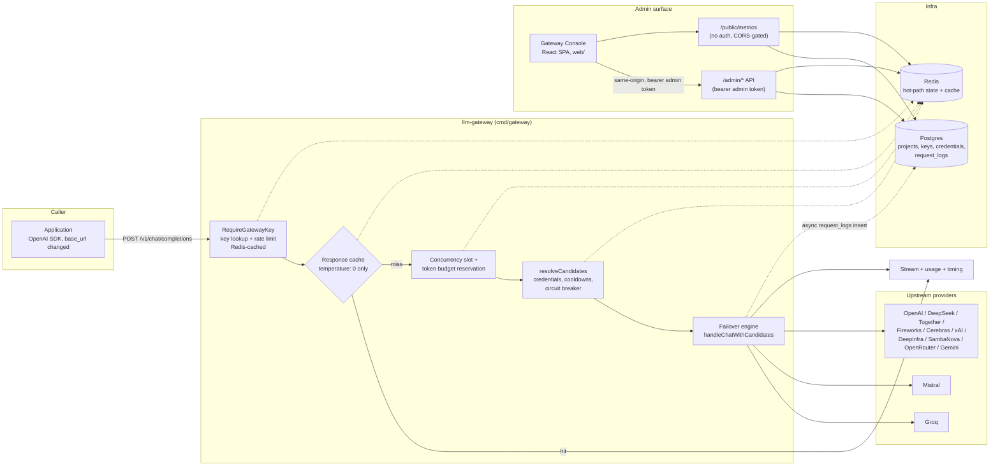
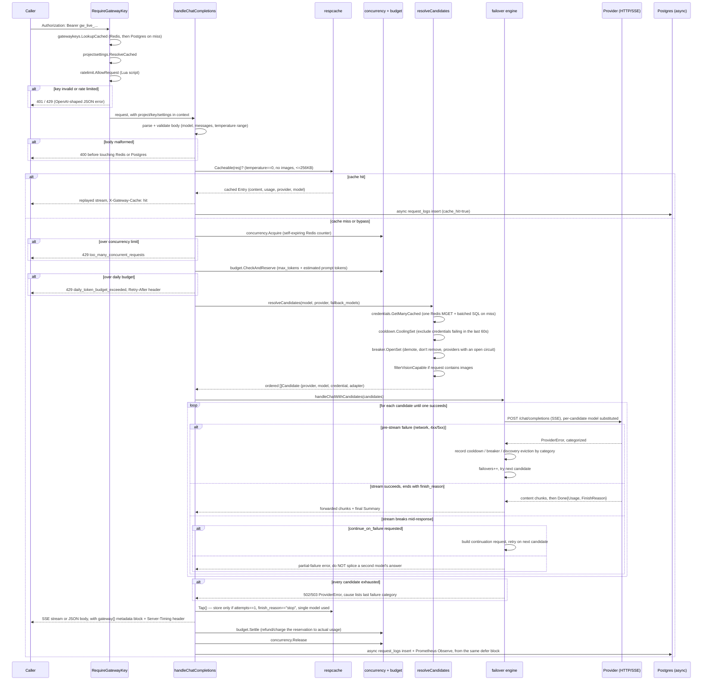
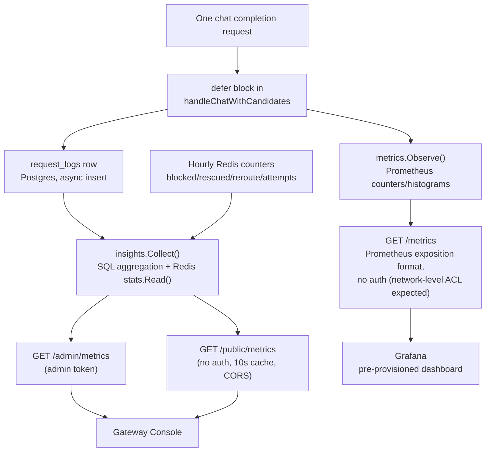
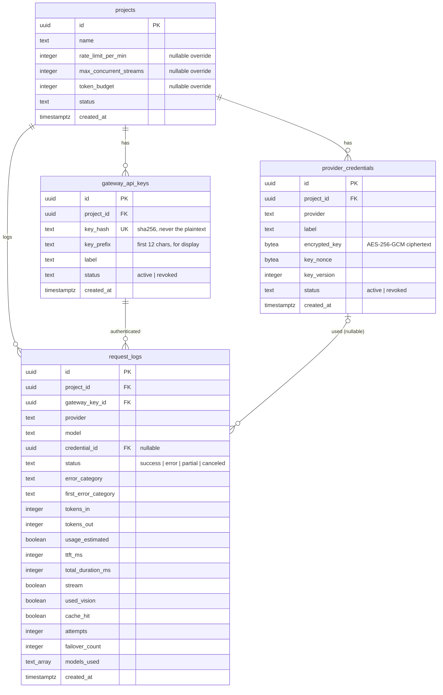
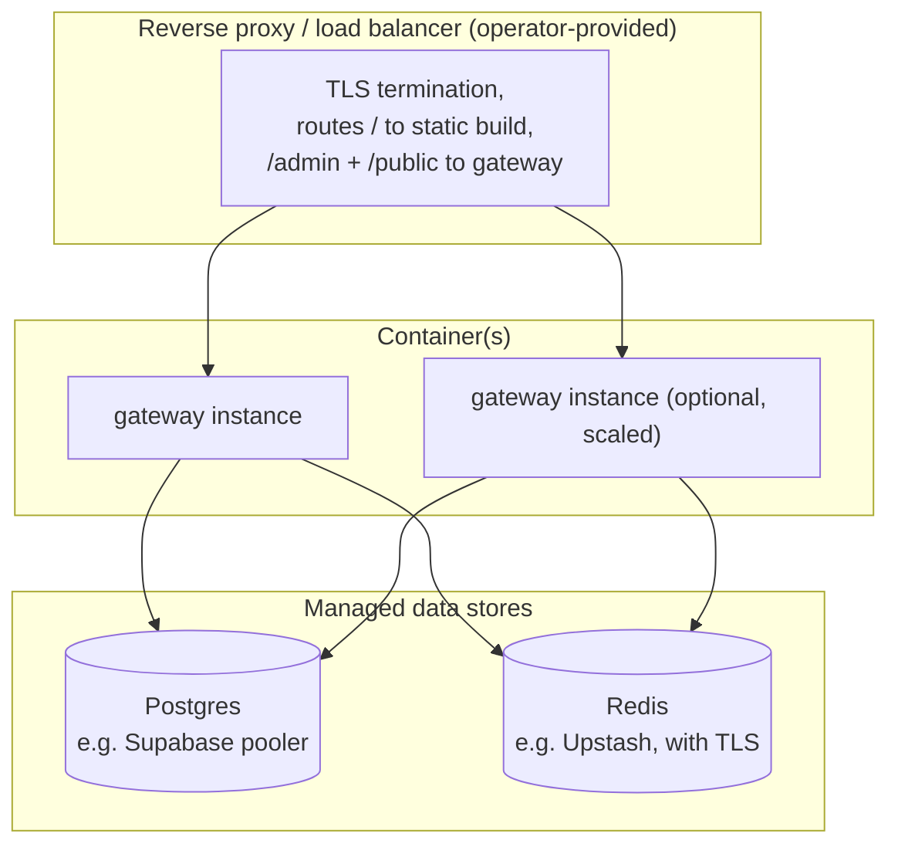
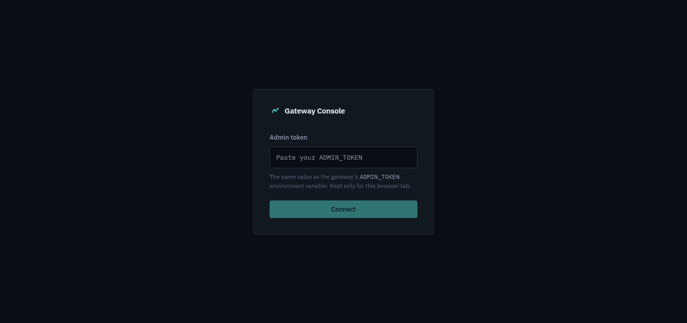

# llm-gateway — System Architecture

**Status:** Full-stack reference — Go backend (`internal/`, `cmd/`) and the React admin console (`web/`)
**Scope:** Everything that ships in this repository: the request-serving gateway, the admin/metrics API, the observability pipeline, the demo/chaos tooling, and the frontend that consumes it.

---

## 1. Executive Summary

llm-gateway is a self-hostable, OpenAI-compatible reverse proxy that sits between an application and one or more LLM providers. An application that already uses the OpenAI SDK adopts it by changing one thing — `base_url` — and gains, without any other code change: automatic failover across models, providers and every API key a project owns; a Redis-backed response cache for deterministic (`temperature: 0`) requests; per-project rate limiting, concurrency capping and a daily token budget that settles to *actual* usage rather than `max_tokens`; encrypted-at-rest provider credentials; and a metrics API built specifically to drive a dashboard.

The backend is a single Go binary (`cmd/gateway`) with two external dependencies: **Postgres** (system of record for projects, credentials, gateway keys and a full request log) and **Redis** (every piece of state that must be read on the hot path of a request: auth, rate limits, budgets, concurrency slots, circuit breakers, credential cooldowns, and the response cache). There is no queueing system, no background worker process, and no message broker — the entire request lifecycle, including request-log persistence, happens inline within the HTTP handler that served the request (persistence itself is fire-and-forget via a goroutine with its own bounded timeout, so it never blocks the client).

A companion single-page app (`web/`) is the admin/observability console: project and credential management, gateway-key issuance, and a metrics dashboard, talking directly to the gateway's own `/admin/*` API with no backend of its own.



---

## 2. System Overview

At a high level, llm-gateway consists of:

- **One stateless HTTP process** (`cmd/gateway`) serving three logical API surfaces from a single `http.ServeMux`: the OpenAI-compatible `/v1/*` surface (gateway-key authenticated), the `/admin/*` management/metrics surface (admin-token authenticated), and an optional unauthenticated, CORS-gated `/public/metrics` surface.
- **Postgres** — system of record for `projects`, `gateway_api_keys`, `provider_credentials`, and `request_logs`. Every write to these tables goes through the standard `database/sql` + `pgx` driver with parameterized queries.
- **Redis** — not a cache in the conventional "optional speedup" sense here: it is where every piece of hot-path admission-control state actually *lives* (rate-limit sliding windows, daily budget counters, concurrency slot counters, circuit-breaker failure counts, credential cooldowns, the response cache, and read-through caches for gateway-key/credential/project-settings lookups that would otherwise be a Postgres round trip on every single request).
- **No background workers, no queue.** This is a deliberate point of departure from a typical "API + worker" service: because the unit of work (serve one chat completion) is itself a single synchronous (from the caller's perspective, streamed) HTTP request/response, there is nothing to defer to a worker. The one thing that happens "after" the response — writing the `request_logs` row — is dispatched as a short-lived goroutine with a 5-second timeout rather than a durable job, which is an intentional reliability/complexity tradeoff (§13.2).
- **Upstream providers** — any service that speaks the OpenAI chat-completions wire format. Twelve are registered out of the box; adding a new one is one entry in a map (§7).
- **The Gateway Console** (`web/`) — a Vite/React/TypeScript single-page app that is *only* a client of the gateway's own `/admin/*` and `/public/metrics` APIs. It has no server component, no database of its own, and adds no new backend routes.
- **Demo/chaos tooling** (`cmd/mockprovider`, `cmd/loadtest`) — a fake OpenAI-compatible upstream with injectable failure modes, and a load generator, both shipped in the production Docker image (as tiny static binaries) so the public `/demo` page and local failover demonstrations work without real provider API keys.

---

## 3. Architectural Principles

Consistently applied across the codebase and worth naming explicitly:

1. **The hot path never blocks on Postgres.** Gateway-key lookup, project settings, and provider credentials are all read through a Redis cache-aside layer with explicit invalidation on write (key revoke, `PATCH /admin/projects/{id}`, new credential). The only synchronous Postgres write on the request path for a *successful* request is none at all — the `request_logs` insert happens in a detached goroutine after the response has already been sent to the client.
2. **Atomic admission control via single Lua scripts.** Rate limiting, concurrency slot acquisition, and token-budget reservation are each one Redis Lua script (`EVAL`), not a read-then-write pair, specifically to close the race window where two concurrent requests could both read "under limit" and both proceed, pushing the counter over the configured ceiling (`internal/budget`'s doc comment is explicit about the previous INCR-then-DECR approach having exactly this bug).
3. **Fail open on availability, fail closed on correctness.** A Redis outage that breaks the gateway-key cache, the project-settings cache, or the circuit breaker degrades to "slower / always-try-every-provider" behavior, not "reject everything" — `demoteUnhealthy` returns candidates unchanged if it can't reach Redis, for example. Conversely, a stream that ends without a clean `finish_reason` is *never* silently treated as a success (§9.4): that would mean billing a partial answer as complete and, worse, could let a continuation request splice a second model's output onto a truncated first one.
4. **Defense in depth on cost and credentials.** Three independent admission gates run before a request reaches a provider — gateway-key rate limit, project concurrency cap, project daily token budget — each with its own Redis-backed counter and its own typed rejection. Provider API keys are encrypted at rest with AES-256-GCM and only ever cached in Redis as ciphertext; decryption happens in-process, costing microseconds, right before a candidate is dialed.
5. **Errors are real HTTP statuses, in OpenAI's JSON error shape, everywhere.** A failure before the first token is produced never becomes an HTTP 200 with an error embedded in the body — not for the chat endpoint, not for the admin endpoints, not mid-stream (where a terminal SSE `data:` event carries the error instead). This was a deliberate, named fix partway through the project's history (commit `fae9f22`, `ddd8cf2`) specifically because most OpenAI-compatible SDKs parse error bodies as JSON and surface a readable message only when the shape matches.
6. **One shared adapter, not one per provider.** Every supported provider speaks (a close variant of) the OpenAI chat-completions wire format, so there is exactly one `Provider` implementation (`OpenAICompatProvider`) parameterized by base URL and two small behavioral flags (`StreamUsage`, `MaxCompletionTokens`). Four separate near-identical adapters existed early in the project's history and were explicitly collapsed into this one (`51a2532 refactor(providers): replace four near-identical adapters with one OpenAI-compatible adapter`) — adding a thirteenth provider is a four-line entry in `registry.go`, not a new file.
7. **Observability is derived from one measurement, not computed twice.** The Prometheus counter/histogram observation and the `request_logs` row for a given request are both written from the same `defer` block in `handleChatWithCandidates`, from the same local variables — so a dashboard figure and a historical log row can never disagree about what happened on a request.
8. **The admin surface has no session, no RBAC, and is explicit about it.** There is one static bearer token (`ADMIN_TOKEN`), compared in constant time, gating every `/admin/*` route uniformly. This is a conscious scope decision (§15, SECURITY.md §1) appropriate to a self-hosted, single-operator gateway, not an oversight — and the frontend is built around that same constraint rather than pretending a richer auth model exists.

---

## 4. Repository Structure

```
llm-gateway/
├── cmd/
│   ├── gateway/            # Production entrypoint: config, DB/Redis connect, migrate, serve
│   │   └── main.go         #   also doubles as the container's HEALTHCHECK command (-healthcheck flag)
│   ├── genkey/              # One-shot CLI: prints a random 32-byte hex ENCRYPTION_KEY
│   ├── mockprovider/        # Fake OpenAI-compatible upstream with chaos modes (ok/down/ratelimit/flaky)
│   └── loadtest/            # Load generator + project/credential/key seeder for the failover demo
│
├── internal/
│   ├── applog/              # slog.Logger constructor (JSON handler, stdout)
│   ├── breaker/              # Per-provider circuit breaker (Redis-backed, shared across instances)
│   ├── budget/                # Daily per-project token budget: atomic reserve + settle-to-actual
│   ├── concurrency/            # Per-project concurrent-stream cap (self-expiring Redis counter)
│   ├── config/                  # Fail-fast env var loading (required vars, typed parsing, defaults)
│   ├── cooldown/                  # Per-credential 60s cooldown after a key-fault failure
│   ├── credentials/                # Provider credential CRUD + AES-GCM encrypt/decrypt + Redis cache
│   ├── crypto/                      # AES-256-GCM encrypt/decrypt primitives
│   ├── db/                           # Postgres connection pool, embedded SQL migration runner
│   │   └── migrations/                #   000001_init_schema, 000002_observability (up/down pairs)
│   ├── discovery/                      # Live /models discovery per provider (Redis-cached, single-flight lock)
│   ├── gatewaykeys/                     # Gateway API key issuance, hashed lookup, Redis cache, revocation
│   ├── httpserver/                       # The HTTP layer: routing, auth middleware, all handlers
│   │   ├── server.go                      #   New() builds the mux; health checks; graceful shutdown
│   │   ├── auth.go / adminauth.go          #   RequireGatewayKey / RequireAdminToken middleware
│   │   ├── chat.go                          #   POST /v1/chat/completions — the full request lifecycle
│   │   ├── stream.go                         #   SSE + non-streaming response writers, OpenAI-shaped
│   │   ├── admin.go                           #   project/credential/gateway-key CRUD handlers
│   │   ├── metrics.go                          #   /admin/metrics, /public/metrics, CORS wrapper
│   │   ├── models.go                            #   GET /v1/models
│   │   └── apierror.go / errors.go               #   OpenAI-shaped JSON error helpers
│   ├── insights/                           # Aggregates request_logs + Redis counters into the dashboard Report
│   ├── metrics/                             # Prometheus collectors (RequestsTotal, TTFTSeconds, RequestDurationSeconds)
│   ├── projectsettings/                      # Per-project overrides (rate limit/concurrency/budget) + Redis cache
│   ├── providers/                             # The routing/failover core
│   │   ├── registry.go                         #   providerSpec map: base URL + behavior flags per provider
│   │   ├── resolve.go                           #   model→provider inference, candidate chain construction
│   │   ├── handler.go                            #   HandleChat / handleChatWithCandidates — the failover engine
│   │   ├── openaicompat.go                        #   OpenAICompatProvider: the one real Provider implementation
│   │   ├── errors.go                               #   ErrorCategory taxonomy + ProviderError
│   │   ├── types.go / provider.go / candidate.go    #   Request/Chunk/Summary/Candidate domain types
│   │   └── fake_provider.go                          #   Test double implementing the Provider interface
│   ├── ratelimit/                           # Per-gateway-key sliding-window limiter (single Lua script)
│   ├── redisclient/                          # Redis connection with bounded timeouts + pool size
│   ├── requestlog/                            # request_logs insert/read (Insert, InsertWithTimeout, LastUsedAt)
│   ├── respcache/                              # Exact-match response cache, epoch-based O(1) invalidation
│   └── stats/                                    # Hourly Redis counters for blocked/rescued/reroute events
│
├── web/                                   # Gateway Console — React admin & metrics SPA (see §24)
├── deploy/
│   ├── prometheus/                         # Scrape config pointed at the gateway's own /metrics
│   └── grafana/                             # Provisioned datasource + a pre-built dashboard JSON
├── scripts/
│   └── seed_demo_data.sql                  # Bulk-inserts request_logs rows for realistic dashboard screenshots
├── Dockerfile                              # Multi-stage build → distroless/static final image
├── docker-compose.yml                      # Postgres + Redis + gateway + Prometheus + Grafana
├── docker-compose.demo.yml                 # Overlay: two mockprovider instances, no real API keys needed
└── .env.example                            # Every configuration variable, documented inline
```

---

## 5. Request Lifecycle — `POST /v1/chat/completions`

This is the single most important code path in the system; nearly every other package exists to support one step of it. Source: `internal/httpserver/chat.go`, `internal/httpserver/auth.go`, `internal/providers/{resolve,handler,openaicompat}.go`.



### 5.1 Why admission control runs in this order

Cache lookup happens **before** concurrency/budget admission, deliberately: a cache hit costs no provider tokens and holds no provider connection open, so it should consume neither a concurrency slot nor budget. Concurrency is acquired **before** budget is reserved (not the reverse) so that a budget rejection — which is comparatively more likely to be transient/recoverable from the caller's perspective (`Retry-After` is given) — never leaves a concurrency slot leaked; the `defer` releases it unconditionally regardless of which gate failed. Parsing and validating the request body happens **before any Redis call at all**, so a malformed request (bad JSON, empty `messages`, out-of-range `temperature`) is cheap and never touches external state.

### 5.2 Token budget: reserve-then-settle, not count-after-the-fact

`budget.CheckAndReserve` reserves `max_tokens + EstimatePromptTokens(req)` **before** the request is sent to any provider, via a single Lua script that checks-and-increments atomically (closing the race the project's history explicitly calls out: a prior `INCR`-then-`DECR` implementation could transiently push the counter over the limit under concurrent load). After the response completes — successfully, partially, or not at all — `budget.Settle` is called from the handler's `defer`, with the actual token count (from the provider's own usage report, or an estimate from characters streamed if the connection died mid-response) and adjusts the day's counter by the signed delta between what was reserved and what was actually used. This means a request that finishes early is refunded instead of permanently charging the full `max_tokens`, and a request that dies with zero output still settles to near-zero cost instead of being charged the full reservation.

### 5.3 The response cache is correctness-first, not hit-rate-first

`respcache.Cacheable` is intentionally narrow: only requests with `temperature` **explicitly** set to `0` qualify (a request that omits `temperature` is not assumed to be deterministic), with no image content, and under a 256KB combined message size. `respcache.Tap` only stores an answer if it came from exactly one attempt (`Attempts == 1`), ended with `finish_reason == "stop"` (not a continuation-stitched or truncated answer), and used exactly one model — a failed-over or continued answer is never cached, because caching it would mean silently serving a degraded response as if it were the primary model's clean output. Cache invalidation is epoch-based: a per-project Redis integer is bumped on `DELETE /admin/projects/{id}/cache`, and every cache key embeds the epoch it was written under, so every previous entry for that project becomes unreachable in O(1) — no `SCAN`/`DEL` storm — and a response that was mid-flight during the flush cannot write a stale entry back in, because `Set` re-checks the epoch hasn't moved before writing (§9.3).

---

## 6. Failover Engine — Error Taxonomy and Recovery Actions

`internal/providers/errors.go` defines exactly four error categories, and every provider failure is classified into one of them before the failover engine decides what to do next:

| Category | Typical cause (HTTP from upstream) | Failover engine's reaction | Side effect recorded |
|---|---|---|---|
| `KeyFault` | 401, 402, 403, 429 — bad/exhausted/rate-limited key | Try the next candidate (another key or another provider) | `cooldown.MarkFailed` — this credential excluded from candidate selection for 60s |
| `ProviderTransient` | 408, 5xx, connection error | Try the next candidate | `breaker.RecordFailure` (counts toward opening that provider's circuit) + `discovery.RecordProviderTransient` |
| `BadModel` | 404 | Try the next candidate | `discovery.EvictModel` — removes the model from the provider's cached discovery list |
| `NonRetryable` | 4xx that isn't one of the above (malformed request the upstream itself rejected) | **Abort the whole chain immediately** — trying another provider won't fix a request the client sent wrong | None (nothing provider-specific to penalize) |

A bare Go `error` that isn't already a `*ProviderError` (e.g. "connection refused" from the transport layer) is treated as `ProviderTransient` by default — the conservative choice, since failing over is nearly always better than giving up on a plain network error.

### 6.1 Mid-stream failure handling (`continue_on_failure`)

A stream can fail after already producing partial content — most dangerously, after the client has already been forwarded some of that content. The engine distinguishes three outcomes once a stream breaks:

1. **`NonRetryable` mid-stream** — abort immediately; forwarding a continuation attempt risks the client ending up with an incoherent splice of two different models' phrasing.
2. **`continue_on_failure: true` in the request** — build a *continuation request*: the original messages, plus the partial assistant content already produced, plus an explicit instruction ("Continue your previous response exactly where it left off... do not restart or summarize"), sent to the next candidate in the chain. This is the one case where the engine deliberately produces output that is a composite of two provider calls — because the caller opted in, and the instruction makes the seam as clean as possible.
3. **Default (no opt-in)** — the stream fails outright with a `502` and an explicit `"stream failed mid-response"` error; the engine never silently serves a truncated answer as if it were complete, and never attempts a continuation the caller didn't ask for.

### 6.2 Candidate chain construction (`resolveCandidates`)

1. **Choice list.** If the request has no `model`, the chain is a fixed `defaultPriority` (currently Groq → Mistral → OpenRouter). If a `model` is given, it's resolved to a `(provider, model)` pair via `resolveChoice`: an explicit `"provider"` field wins, then a `"provider:model"` prefix (only honored if the prefix is a *known* provider name, so model IDs that legitimately contain a colon — e.g. OpenRouter's `"...:free"` suffix style — aren't misparsed), then a built-in `modelToProvider` shortcut table for common bare model names. Any `fallback_models` are resolved the same way and appended; an unresolvable fallback is logged and skipped rather than failing the whole request.
2. **Credentials.** One `credentials.GetManyCached` call fetches every active credential for every provider in the chain, in a single Redis `MGET` plus (on cache miss) one batched SQL query — not one round trip per provider per request.
3. **Cooldown filtering.** One `cooldown.CoolingSet` Redis round trip checks which of those credentials recently key-faulted; cooling ones are excluded from this round of candidates (they're not deleted — the cooldown is time-bounded).
4. **Load spreading.** If a provider has more than one usable credential, the starting offset is randomized (`rand.Intn`) so repeated requests don't always hit the same key first — multiple keys on one provider share rate-limit load instead of the first key absorbing all of it.
5. **Circuit-breaker demotion.** `demoteUnhealthy` checks `breaker.OpenSet` for every provider in the chain; candidates whose provider has an open circuit are moved to the *back* of the list, never removed — if every provider is unhealthy, they're still all tried, in original order, rather than returning an immediate failure.
6. **Vision filtering.** If any message contains an image, candidates are filtered down to models in the `visionCapableModels` allow-list; if none remain, the request fails with a clear client error rather than silently dropping the image or sending it to a model that can't use it.

---

## 7. Adding a Provider

Every built-in provider is one entry in `internal/providers/registry.go`'s `providerRegistry` map:

```go
"groq": {BaseURL: "https://api.groq.com/openai/v1", StreamUsage: true},
```

`StreamUsage` controls whether the gateway asks for `stream_options.include_usage` (only sent to providers known to accept it, so the gateway never sends a parameter an upstream might reject outright); `MaxCompletionTokens` controls whether `max_tokens` or the newer `max_completion_tokens` field is sent (OpenAI itself requires the latter). Both the base URL and the stream-usage flag can be overridden per-provider at runtime via `PROVIDER_<NAME>_BASE_URL` / `PROVIDER_<NAME>_STREAM_USAGE` environment variables — the mechanism the demo overlay (`docker-compose.demo.yml`) uses to point `groq` and `mistral` at local `mockprovider` instances with zero code changes.

Because every provider is driven through the single `OpenAICompatProvider` adapter, supporting a new OpenAI-compatible upstream never requires a new Go file, a new test double, or a new code path in the failover engine — only this registry entry, and (if the model should be reachable by bare name without an explicit `"provider"` field) an entry in `modelToProvider`.

---

## 8. Admission Control — Three Independent Gates

Three separate limits are enforced for every chat completion request, each with its own Redis-backed state and its own HTTP status/error code, and each individually configurable per project (falling back to a server-wide default when unset):

| Gate | Package | Mechanism | Scope | Default | Rejection |
|---|---|---|---|---|---|
| Rate limit | `ratelimit` | Sliding-window log (sorted set), one Lua script | Per gateway key | `DEFAULT_RATE_LIMIT_PER_MIN` (60/min) | `429 rate_limit_exceeded` |
| Concurrency | `concurrency` | Self-expiring counter (15-min TTL), one Lua script per acquire/release | Per project | `DEFAULT_MAX_CONCURRENT_STREAMS` (10) | `429 too_many_concurrent_requests` |
| Token budget | `budget` | Reserve-then-settle counter, UTC-day key, one Lua script per reserve/settle | Per project | `DEFAULT_TOKEN_BUDGET` (100,000/day) | `429 daily_token_budget_exceeded`, `Retry-After` set |

All three are checked **before** a provider is ever contacted, in the order rate limit (in the auth middleware, before the handler even runs) → concurrency → budget (inside the handler). Each rejection is counted into the hourly Redis stats bucket (`stats.RateLimited`, `stats.BudgetBlocked`, `stats.ConcurrencyBlocked`) that feeds the dashboard's "protection" panel — so an operator can see *how much* traffic was stopped before it cost anything, not just that a 429 happened somewhere in a log.

The self-expiring design on the concurrency counter specifically defends against a crashed process: if the gateway is killed between `Acquire` and the deferred `Release` (panic, OOM-kill, forcible container termination), the slot key's own TTL reclaims it within 15 minutes rather than permanently wedging a project's concurrency budget at zero.

---

## 9. Caching and State — Redis Key Space

Every piece of Redis state the gateway uses, in one place, since understanding what's in Redis is close to understanding the whole hot path:

| Key pattern | Package | Purpose | TTL / lifetime |
|---|---|---|---|
| `gwkey:<sha256>` | `gatewaykeys` | Gateway-key auth lookup (positive + negative caching) | 5 min positive, 15s negative |
| `projcfg:<projectID>` | `projectsettings` | Per-project rate limit/concurrency/budget overrides | 5 min, evicted on `PATCH` |
| `creds:<projectID>:<provider>` | `credentials` | Encrypted credential list for a project+provider | 5 min, evicted on create/revoke |
| `ratelimit:<gatewayKeyID>` | `ratelimit` | Sliding-window sorted set of request timestamps | Rolling, pruned on read |
| `concurrent:<projectID>` | `concurrency` | In-flight request counter | Self-expires, 15 min |
| `budget:<projectID>:<YYYY-MM-DD>` | `budget` | Daily token counter (UTC) | 25h (covers clock skew past day boundary) |
| `cooldown:<credentialID>` | `cooldown` | Marks a credential as recently key-faulted | 60s |
| `breaker:<provider>` | `breaker` | Rolling failure count for a provider's circuit | 30s window, resets on success |
| `discovery:<provider>` | `discovery` | Cached `/models` list from the provider itself | 6h, single-flight lock on refresh |
| `respcache:epoch:<projectID>` | `respcache` | Current cache epoch for a project | Indefinite (incremented, never expired) |
| `respcache:<projectID>:<epoch>:<hash>` | `respcache` | Cached response entry | `CACHE_TTL_SECONDS` (default 1h) |
| `gwstats:<scope>:<YYYYMMDDHH>` | `stats` | Hourly counters: blocked/rescued/reroute/per-provider-attempt events | 8 days |
| `pubmetrics:<projectID>:<window>` | `httpserver` | Cached `/public/metrics` response body | 10s |

Nothing in this table is a single point of failure for *correctness* — see Principle 3 (§3): a Redis outage degrades the gateway toward "slower and more permissive" (caches miss, breakers never open, cooldowns are never applied), never toward serving wrong answers or leaking credentials. It **is** a point of failure for *throughput and cost protection*, since rate limiting, budget enforcement and concurrency capping all live there — this tradeoff is explicit, not accidental (SECURITY.md §9 covers it from the security angle).

---

## 10. Observability Pipeline

Three outputs are produced from the same underlying measurements, so they never disagree:



- **`request_logs` (Postgres)** — one row per completed request: provider/model actually used, status, error category, tokens in/out (and whether they were estimated), TTFT and total duration, cache hit, attempt and failover counts, and every model tried (`models_used`). This is the detailed historical record and backs everything in `insights.Report` that needs percentiles or per-request detail (recent requests, latency distributions).
- **`stats` package (Redis, hourly buckets)** — cheap counters for events that never produce a `request_logs` row at all: a request rejected by rate limit/budget/concurrency before it ever reached a provider, and *every individual upstream attempt* including ones that failed and were absorbed by failover (so a provider that failed 4 times before the 5th candidate succeeded shows all 5 attempts, not just the 1 that appears as the "final" provider in `request_logs`).
- **Prometheus (`internal/metrics`)** — three collectors (`gateway_requests_total` counter, `gateway_ttft_seconds` and `gateway_request_duration_seconds` histograms), registered against a **dedicated** registry rather than `prometheus.DefaultRegisterer`, specifically so `/metrics` exposes exactly and only this service's own series with no risk of a future dependency silently adding unrelated ones.
- **`insights.Collect`** merges both sources into one `Report` document (§11), parameterized by a time window (`1h`/`6h`/`24h`/`7d`/`all`) and an optional project filter. This is the single function both `/admin/metrics` and `/public/metrics` call — the only difference between those two endpoints is authentication, CORS, and response caching, never the data shape.

---

## 11. The Metrics Report Shape

`insights.Report` (`internal/insights/insights.go`) is deliberately one JSON document answering a fixed set of questions, not a generic metrics-dump API:

- **`reliability`** — not just success rate, but specifically *rescue* rate: of the requests that hit at least one upstream failure, how many still succeeded because failover tried another candidate? Broken down further by which failure category was rescued (rate limits, outages, bad model) and how many times the circuit breaker rerouted away from an unhealthy provider before any failure even occurred on this particular request.
- **`latency`** — p50/p95/p99 total duration and p50/p95 time-to-first-token, computed via Postgres `percentile_cont`.
- **`cache`** — hit rate, tokens saved (an estimate: a cache hit avoided buying those tokens from a provider again), and a `speedup` figure (median miss latency ÷ median hit latency, hit latency floored at 1ms so the ratio is a conservative lower bound).
- **`usage`** — token totals and stream vs. non-stream request counts.
- **`protection`** — requests blocked by each admission gate, sourced entirely from the Redis `stats` counters (independent of `request_logs`, since these requests never reached a provider).
- **`providers`** — a per-provider scoreboard: share of traffic, success rate, p50/p95/TTFT, token volume, and attempt counts split by failure category. Providers that only ever *failed* (never once appeared as the final successful provider in `request_logs`) are still surfaced here, sourced from the Redis attempt counters, so a total outage on one provider is visible rather than silently absent from the report.
- **`timeseries`** — gap-filled with explicit zero-valued points for empty buckets, so a chart never needs its own interpolation logic; bucket width scales with window (1 min for `1h`, up to 1 day for `all`).
- **`recent`** — the last 15 requests, newest first, for a live activity feed.

Every nullable field (`*_ms`, `*_rate`) is a Go pointer, serialized as JSON `null` when there's genuinely no data for that window (e.g. zero requests, zero cache hits) — **never coerced to `0`** — because `0ms` and "no data" mean materially different things to a reader of a dashboard, and the frontend is built around preserving that distinction (§24.6).

---

## 12. Data Model



Two migrations define the whole schema (`internal/db/migrations/000001_init_schema.up.sql`, `000002_observability.up.sql`), applied by an embedded Go migration runner (`internal/db/migrate.go`) rather than an external tool — `go:embed` bundles the `.sql` files into the binary itself. The runner is safe to invoke on every boot: it takes a Postgres advisory lock so multiple instances starting simultaneously don't race on applying the same migration, tracks applied versions in a `schema_migrations` table, and — notably — detects a database that was bootstrapped by hand from the raw `000001` file before this runner existed (the `projects` table exists but `schema_migrations` doesn't) and baselines it at version 1 instead of failing on "relation already exists." This baselining path exists specifically because `docker-compose.yml`'s Postgres container applies `000001` via the image's own `docker-entrypoint-initdb.d` mechanism on first boot (so the demo stack starts with zero migration-runner dependency), and the gateway's own `AUTO_MIGRATE` path then needs to recognize that state and apply only what's missing (`000002` onward).

**Credentials are never deleted, only revoked** (`status = 'revoked'`) — preserving the row lets `request_logs.credential_id` keep a valid historical foreign key and lets `LastUsedAt` report when a since-revoked credential was last used. The same pattern applies to gateway keys.

---

## 13. Reliability Design

### 13.1 Circuit breaker — shared state, not per-instance

`internal/breaker` keeps one failure counter per provider in Redis (not in-process memory), specifically so that if the gateway runs as multiple instances behind a load balancer, they all agree on whether a provider is currently unhealthy — one instance doesn't keep hammering a dead provider while its siblings have already routed around it. Five transient failures within a 30-second rolling window opens the breaker; a single success closes it immediately. An open breaker never *removes* a provider from the candidate list — only demotes it to the back — so a provider coming back online is still periodically tried (by requests whose other candidates also fail) and self-heals the moment one of those attempts succeeds.

### 13.2 Why request-log persistence is "best-effort async," not a durable queue

The design explicitly accepts that a `request_logs` row can be lost if the process crashes between sending the response and the detached goroutine's insert completing (bounded by a 5-second timeout). This is a conscious tradeoff: adding a durable queue (and the operational surface area of a broker) purely to guarantee zero-loss *logging* — as opposed to the actual service being provided, which is the chat completion itself, already fully delivered to the client by this point — was judged not worth the complexity for what is fundamentally observability data, not transactional state. The alternative (writing the log synchronously, in the request path, before responding) was rejected because it would mean every request's latency includes a Postgres round trip that has nothing to do with serving the actual completion.

### 13.3 Graceful shutdown

`RunWithGracefulShutdown` (`internal/httpserver/server.go`) listens for `SIGINT`/`SIGTERM` and calls `http.Server.Shutdown`, which stops accepting new connections and waits (up to a 25-second grace period) for in-flight requests — including long-lived SSE streams — to finish naturally. This matters specifically because a streaming chat completion can legitimately run for many seconds, and an abrupt process kill (rather than a graceful one) would not only cut the stream mid-response but skip the deferred `concurrency.Release` call, permanently leaking a concurrency slot until its own 15-minute self-expiry (§8). The container's `HEALTHCHECK` (via `gateway -healthcheck`, not `curl`, since the distroless final image has no shell — §16.1) lets an orchestrator avoid routing new traffic to an instance mid-shutdown or mid-startup.

### 13.4 Health checks are real, not unconditional

`/healthz` and `/readyz` share one implementation that actually pings Postgres and Redis (each bounded to a 2-second timeout so a hung dependency can't hang the health check itself) and report `503` if either is unreachable — not an unconditional `200 ok`. Both routes currently answer the same question; they're kept as two separate routes specifically so a deployment platform that distinguishes liveness from readiness has somewhere correct to point each at, and so the two can diverge later (e.g. a future in-process warm-up state affecting readiness but not liveness) without a routing change.

---

## 14. Security Architecture (Summary — full detail in SECURITY.md)

| Layer | Mechanism |
|---|---|
| Gateway-key auth | SHA-256 hash stored, not the plaintext; Redis-cached lookup with negative caching to blunt brute-force probing |
| Admin-token auth | Single static bearer token, `crypto/subtle.ConstantTimeCompare` |
| Credential storage | AES-256-GCM, random nonce per encryption; only ciphertext ever cached in Redis |
| Credential exposure | Never returned by any API once created — admin listing endpoints return metadata only (label, status, timestamps) |
| Gateway-key exposure | Plaintext shown exactly once, at creation; every listing thereafter shows only a stored prefix |
| Request body limits | 10MB on `/v1/chat/completions`, 1MB on every `/admin/*` write |
| CORS | Applied **only** to `/public/metrics`; every `/admin/*` and `/v1/*` route gets no CORS headers at all, by design |
| Revocation | Immediate — both DB write and Redis cache eviction happen in the same call, so a revoked key/credential stops working on the very next request, not after a cache TTL |

---

## 15. Deployment Topology



The gateway is intentionally stateless at the process level — all cross-request state lives in Postgres or Redis — so horizontal scaling is adding instances behind a load balancer with no session affinity required. The one deployment constraint that matters for the frontend specifically: `/admin/*` has no CORS headers (§14), so the Gateway Console **must** be served same-origin with the gateway (a reverse proxy routing `/` to the static build and `/admin`, `/public` through to the Go binary on the same origin) — this is a deployment-level requirement, not something the backend widens its CORS policy to work around (§24.1.2 covers the reasoning).

### 15.1 Container image

The `Dockerfile` is a two-stage build: a full `golang:1.25-bookworm` build stage produces four statically linked binaries (`CGO_ENABLED=0`, `-trimpath -ldflags="-s -w"`) — `gateway`, `genkey`, and the demo tools `mockprovider`/`loadtest` — and the final image is `gcr.io/distroless/static-debian12:nonroot`: no shell, no package manager, no OS utilities beyond CA certificates (required for outbound HTTPS to provider APIs) and whatever the statically-linked binaries themselves need, which is nothing beyond the Go runtime. This is why the container's `HEALTHCHECK` is implemented as a mode of the `gateway` binary itself (`-healthcheck` flag) rather than the conventional `curl localhost:8080/healthz` — there is no `curl` in the image to run.

---

## 16. Frontend Architecture (Summary)

This section covers the Gateway Console (`web/`) as part of the whole-system view.



- **Stack:** React 18 + TypeScript, Vite, React Router, TanStack Query (all server state), Recharts, plain CSS with design tokens for a dark theme. No state-management library beyond TanStack Query, no CSS framework, no GraphQL.
- **It is a pure client of the gateway's own API** — no backend of its own, no new routes added to the Go service to support it, no mocked data in production use (local dev proxies `/admin` and `/public` through Vite's dev server to a real running gateway).
- **Pages:** Dashboard (overview + charts), Providers (per-provider scoreboard), Projects / Project Detail (settings, credentials, gateway keys — scoped per-project, matching the backend's own data model), Requests (recent activity table), and a public, token-free `/demo` page that renders the `all`-window public metrics report for visitors with no admin token, falling back to a recorded-run fixture if the live endpoint is unreachable.
- **Auth model mirrors the backend's:** one operator-entered admin token, held in `sessionStorage` (not `localStorage`, to reduce exposure window), sent only as an `Authorization: Bearer` header to same-origin `/admin/*` calls; a `401` from any call clears the token and returns to the entry gate.
- **Null-safety is a first-class design requirement:** every latency/rate figure that the backend can legitimately report as "no data" (a JSON `null`) is rendered as a visually distinct "—", never coerced to `0`, because the backend already does the work of distinguishing the two and collapsing them in the UI would misrepresent real data.

---

## 17. Testing Strategy

- **Unit tests** alongside nearly every package (`*_test.go`) — notably `internal/crypto/crypto_test.go` covers GCM tamper detection explicitly, and `internal/providers/resolve_test.go` / `handler_test.go` exercise candidate resolution and failover logic against `fake_provider.go`, a hand-written `Provider` test double, rather than real network calls.
- **Integration tests** (`internal/httpserver/server_integration_test.go`) exercise the HTTP layer against a real Postgres and Redis.
- **End-to-end tests** (`internal/httpserver/e2e_test.go`) spin up the full mux against real Postgres/Redis and a fake SSE upstream (`httptest.Server`), and assert on externally observable behavior: usage/timing on every response, failover being invisible to the client while fully recorded in metrics, the response cache's hit/miss/bypass/flush lifecycle, streaming responses being OpenAI-shaped, the token budget settling to actual usage, errors being real HTTP statuses in OpenAI's JSON shape, revocation and `PATCH` taking effect on the very next request (not after a cache TTL), the public metrics endpoint's CORS behavior, and the circuit breaker actually routing around a down provider.
- **Live provider integration tests** (`*_integration_test.go` for Groq, Mistral, Gemini, OpenRouter) are skipped by default and only run when the corresponding real API key environment variable (`GROQ_API_KEY`, etc.) is present — so CI never depends on live provider credentials, but a contributor with keys can opt in locally.
- **`go test -race ./...`** runs in CI against real Postgres and Redis service containers (`.github/workflows/ci.yml`), specifically because so much of this codebase's correctness lives in concurrent access to shared Redis-backed counters.
- **Frontend tests** (Vitest + React Testing Library) target the two places a subtle bug would silently misrepresent real data: `lib/format.ts`'s null-safe formatting and `api/client.ts`'s error parsing/auth-header injection.

---

## 18. Demo and Load-Testing Tooling

Two small Go programs, built into the same production image, exist solely to make the gateway's reliability behavior observable without real provider API keys:

- **`cmd/mockprovider`** — a fake OpenAI-compatible upstream with a `/chaos` control endpoint supporting three failure modes: `ok` (normal), `down` (always 503), `ratelimit` (always 429), and `flaky` (fails a configurable fraction of requests). This is what lets `docker-compose.demo.yml` demonstrate real failover — killing the primary mock mid-demo and watching the gateway route around it — without touching a real provider.
- **`cmd/loadtest`** — a load generator with a `seed` mode (creates a demo project, credentials, and gateway key via the real `/admin` API) and a `run` mode (fires concurrent requests and reports success rate, latency, and failover statistics) — this is also what populates realistic data for `scripts/seed_demo_data.sql` and the public `/demo` page's recorded-run fallback.

This tooling is a genuine part of the system's architecture, not a throwaway script: it's shipped in the Dockerfile's final stage deliberately, so the README's "Try the failover demo" walkthrough and the public `/demo` page both work in any environment the image runs in, with zero external dependencies beyond the compose stack itself.
