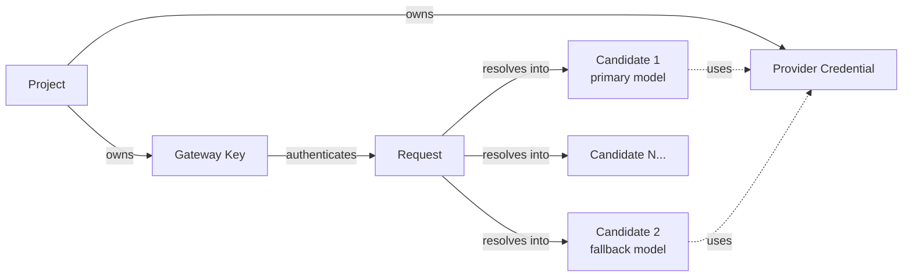
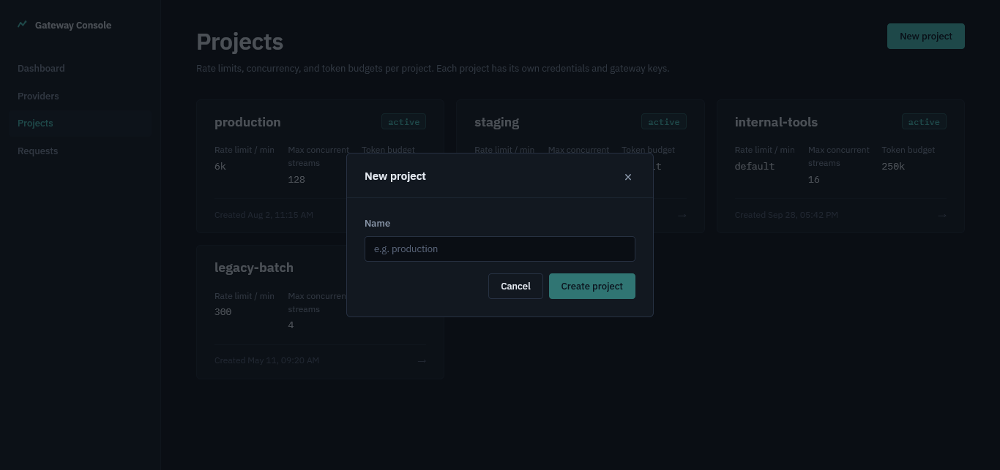
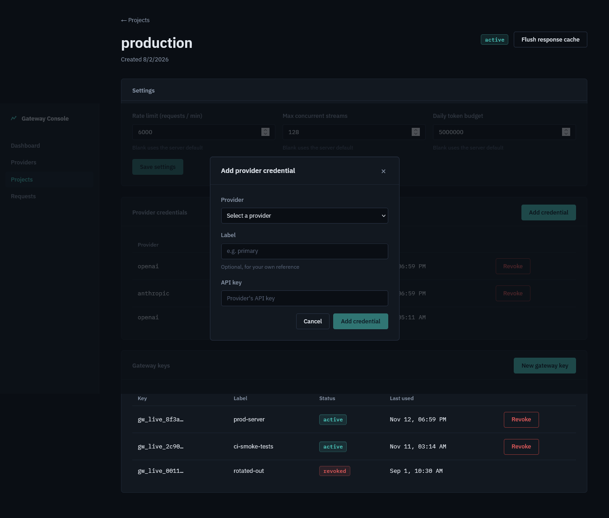
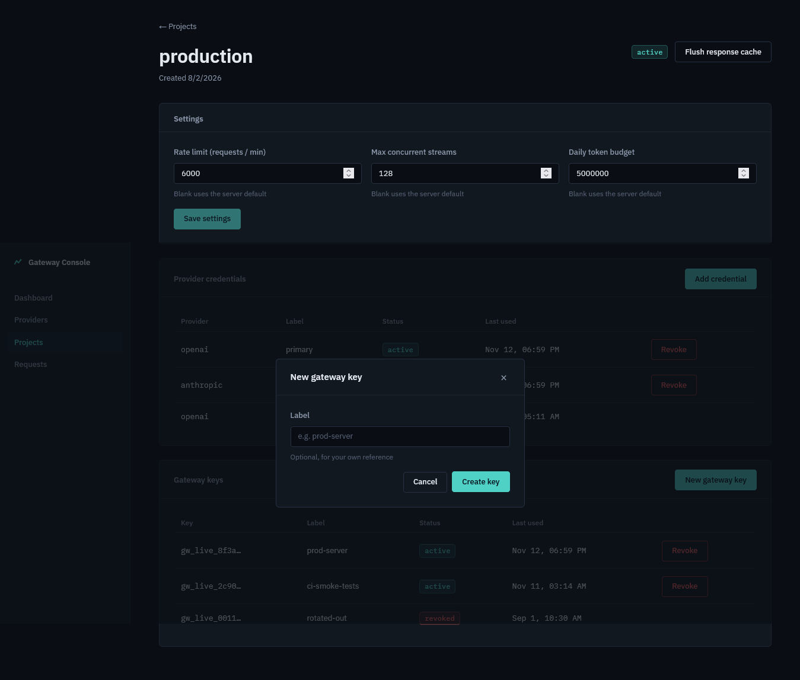
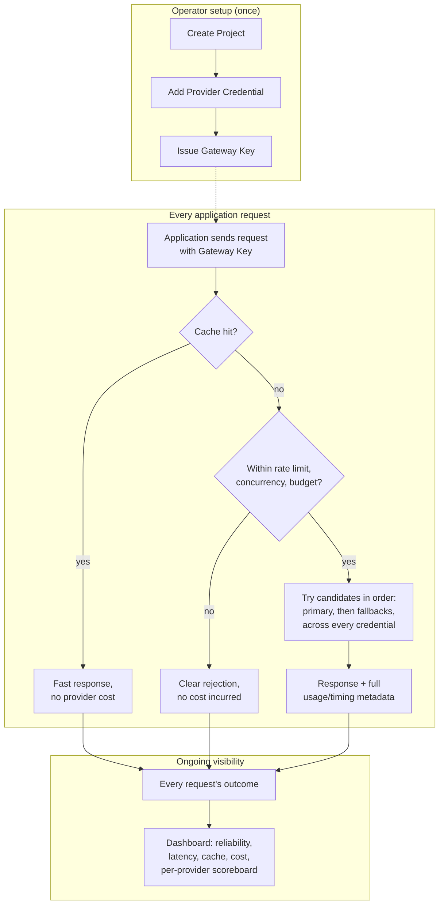

# PRODUCT_OVERVIEW.md
### The Complete Product Intelligence Document for llm-gateway

> **Document purpose:** This is not an architecture document, an API reference, or a security policy. It is the definitive explanation of what llm-gateway *does*, what problem it solves, and how a person actually experiences using it — written so a hiring manager, a product manager, an engineer evaluating it for their own stack, or an investor can understand the entire product without reading a line of Go.

---

## Table of Contents

1. [Executive Summary](#1-executive-summary)
2. [Product Vision](#2-product-vision)
3. [Core Concepts & Domain Model](#3-core-concepts--domain-model)
4. [High-Level System Overview](#4-high-level-system-overview)
5. [Feature Inventory](#5-feature-inventory)
6. [Adoption — Changing One Line](#6-adoption--changing-one-line)
7. [Projects, Gateway Keys & Credentials](#7-projects-gateway-keys--credentials)
8. [Failover — The Core Reliability Story](#8-failover--the-core-reliability-story)
9. [The Response Cache](#9-the-response-cache)
10. [Cost Controls — Rate Limits, Concurrency, Budgets](#10-cost-controls--rate-limits-concurrency-budgets)
11. [Streaming & Non-Streaming Responses](#11-streaming--non-streaming-responses)
12. [Vision / Image Input](#12-vision--image-input)
13. [Model Routing & the Provider Catalog](#13-model-routing--the-provider-catalog)
14. [The Gateway Console (Admin Dashboard)](#14-the-gateway-console-admin-dashboard)
15. [The Metrics & Reliability Story](#15-the-metrics--reliability-story)
16. [The Public Demo Page](#16-the-public-demo-page)
17. [Observability Without Content Retention](#17-observability-without-content-retention)
18. [Self-Hosting & Deployment Experience](#18-self-hosting--deployment-experience)
19. [Security Posture (Product-Level)](#19-security-posture-product-level)
20. [Who This Is For](#20-who-this-is-for)
21. [Who This Is Not For (Yet)](#21-who-this-is-not-for-yet)
22. [Complete End-to-End User Flows](#22-complete-end-to-end-user-flows)
23. [How the Pieces Connect](#23-how-the-pieces-connect)
24. [A Request's Life, Narrated](#24-a-requests-life-narrated)
25. [Product Strengths](#25-product-strengths)
26. [Known Limitations](#26-known-limitations)
27. [Product Roadmap Signals](#27-product-roadmap-signals)
28. [Appendix — Glossary & Terminology](#28-appendix--glossary--terminology)

---

## 1. Executive Summary

**llm-gateway is infrastructure that sits between an application and the LLM providers it talks to, and makes that connection reliable, fast, and cost-controlled — without the application changing anything except one configuration value.**

Any team building on an LLM today runs into the same set of unglamorous but business-critical problems: a provider has an outage or starts rate-limiting you right when traffic spikes; the same prompt gets sent (and paid for) over and over; one misconfigured client or runaway loop burns through a budget in minutes; provider API keys end up scattered across config files and environment variables with no central place to rotate or revoke them; and when something goes wrong, there's no single place to look to understand *what* happened and *how often*.

llm-gateway solves all of these by being a drop-in, OpenAI-compatible proxy. If an application already uses the OpenAI Python or JavaScript SDK (or any SDK that speaks the same wire protocol — which by now is most of them, since the OpenAI chat-completions format has become a de facto standard across the industry), adopting llm-gateway means changing the `base_url` the SDK points at and nothing else. From that point forward, every request automatically gets: failover across models, providers, and every API key the project owns; a response cache that avoids paying for the same deterministic answer twice; rate limiting, concurrency capping, and a daily token budget that actually settles to what was used rather than what was asked for; encrypted storage of every provider credential; and a live dashboard showing exactly how much of that protection is doing real work.

It is self-hosted — one Go binary plus Postgres and Redis — and ships with a companion admin console (a React single-page app) for managing projects, credentials, and gateway keys, and for watching the reliability and cost story unfold in real time.

---

## 2. Product Vision

The LLM provider landscape today looks a lot like the early cloud-hosting landscape: dozens of capable providers, wildly different reliability characteristics minute to minute, aggressive rate limits that bite hardest exactly when you need capacity most, and a growing expectation among teams that they shouldn't have to bet their product's uptime on any single vendor's. The natural answer — the one the industry converged on for compute, for CDNs, for DNS — is an abstraction layer: something that sits in front of the providers, hides their individual quirks and outages behind one stable interface, and lets the application above it stop thinking about any of this.

llm-gateway's vision is to be that layer for LLM providers specifically, built around a small number of durable beliefs:

- **Reliability shouldn't require application-level retry logic scattered across a codebase.** Failover belongs in one place, handled once, correctly, rather than re-implemented (and under-tested) in every service that calls an LLM.
- **"It streamed, so it must have worked" is a dangerous assumption.** A stream that dies halfway through is a real failure mode, and silently splicing a second model's continuation onto a truncated first response — or worse, just serving the truncated fragment as if it were complete — is worse than failing loudly. Correctness under partial failure is a first-class design concern, not an edge case.
- **Cost control needs to be real-time and based on actual usage, not aspirational limits set once and forgotten.** A budget that's checked against `max_tokens` rather than what was actually generated isn't really a budget — it's a guess. A rate limit or concurrency cap that isn't enforced atomically under real concurrent load isn't really a limit.
- **Provider credentials are secrets, and should be treated like it everywhere** — encrypted at rest, never returned by any API once stored, revocable instantly, and never logged.
- **Visibility shouldn't be an afterthought bolted on later.** Knowing how much failover is actually saving you, how much the cache is actually saving you, and which provider is actually reliable *right now* — this week, not last quarter — is the whole point of running something like this instead of just calling providers directly. The product includes the dashboard that answers these questions as a core deliverable, not a stretch goal.
- **Self-hosted means the operator stays in control.** No vendor lock-in to a third-party gateway-as-a-service, no sending request content through someone else's infrastructure beyond the provider you've already chosen to trust, and full ownership of the encryption key protecting your own provider credentials.

---

## 3. Core Concepts & Domain Model

Understanding llm-gateway means understanding five nouns and how they relate. Everything else in the product is a verb applied to these.

- **A Project** is the top-level unit of isolation — typically one application, one team, or one environment (e.g. "production," "staging," a specific customer deployment). A project has its own rate limit, concurrency cap, and daily token budget, each independently configurable or left at the operator's server-wide default.
- **A Gateway Key** is what an application actually authenticates with. It belongs to exactly one project, looks and behaves like an API key an OpenAI SDK already expects, and is the only credential the application-side code ever sees or needs.
- **A Provider Credential** is the real, upstream API key (a Groq key, an OpenAI key, a Mistral key, and so on) that the gateway holds *on behalf of* a project, encrypted at rest, and uses when actually making a request to that provider. The application never sees these — it only ever presents its gateway key.
- **A Request** is one chat completion call. Behind the scenes a single request can involve several attempts against several different candidates (different models, different providers, different credentials) before the application ever sees a response — all of that complexity is absorbed by the gateway and invisible to the caller unless they look at the metadata the response carries.
- **A Candidate** is one specific (provider, model, credential) combination the gateway is willing to try for a given request, in priority order — the primary model first, then any fallback models the caller specified, each potentially tried with more than one credential if a project has several keys for that provider.



---

## 4. High-Level System Overview

From the outside, llm-gateway looks like exactly one thing: an HTTP endpoint that speaks the OpenAI chat-completions API. Underneath, a single request can touch a response cache, three independent cost/abuse protections, a candidate-resolution step that accounts for credential health and provider health, and — if the first attempt fails — one or more additional attempts against other candidates, all before the caller sees a response.

Separately, an administrator interacts with llm-gateway through a management API (and the Gateway Console that wraps it) to create projects, add provider credentials, issue gateway keys, adjust per-project limits, and watch a live metrics dashboard. These two surfaces — the request-serving path and the admin/observability path — are cleanly separated: an application's gateway key can never touch the admin surface, and the admin token can never masquerade as a gateway key.

---

## 5. Feature Inventory

| Feature | What it does | Why it matters |
|---|---|---|
| OpenAI-compatible API | Drop-in replacement for `base_url` on any OpenAI SDK | Zero application code change beyond configuration |
| Automatic failover | Tries fallback models/providers/credentials on failure | A provider outage or rate limit doesn't become your outage |
| Response caching | Caches deterministic (`temperature: 0`) answers | Repeated identical prompts cost nothing the second time |
| Rate limiting | Per-gateway-key request ceiling | One client can't exhaust shared capacity |
| Concurrency capping | Per-project in-flight request ceiling | Bounds how much load one project can place on providers at once |
| Daily token budgets | Per-project spend ceiling, settled to real usage | Real cost control, not an estimate based on `max_tokens` |
| Encrypted credential storage | AES-256-GCM at rest, never returned by any API | Provider keys are protected the way secrets should be |
| Instant revocation | Gateway keys and credentials stop working immediately on revoke | No "wait for the cache to expire" window |
| Circuit breaking | Automatically routes around a provider having a bad minute | Faster recovery, less wasted retry traffic against a dead upstream |
| Usage & timing on every response | Request ID, provider, model, cache status, timing, token counts | Full transparency into how every single request was actually served |
| Streaming + non-streaming | Both OpenAI calling conventions supported | Works with any existing client code either way |
| Vision / image input | Routes image-containing requests only to vision-capable models | No silent failures or garbled output from sending images to a text-only model |
| Metrics dashboard | Reliability, latency, cache, cost-protection, per-provider scoreboard | Answers "is this actually working?" with real numbers, not vibes |
| Public read-only metrics | Opt-in, unauthenticated, aggregate-only endpoint | Powers a public status page or portfolio demo with zero risk of leaking anything sensitive |
| Self-hosted | One Go binary + Postgres + Redis | Full operator control, no third-party gateway dependency |
| Admin console (Gateway Console) | A full React UI for everything above | No API-only product — a real interface to manage and observe it |
| Zero-API-key demo mode | A fake upstream with injectable failure modes | Anyone can see failover and caching working with no real provider account needed |

---

## 6. Adoption — Changing One Line

The entire integration story for an application already using an OpenAI SDK is this:

```python
from openai import OpenAI
client = OpenAI(base_url="http://your-gateway-host/v1", api_key="gw_live_...")
```

Nothing else about how the application calls the model changes — the same `client.chat.completions.create(...)` call, the same message format, the same streaming interface. The gateway key (`gw_live_...`) replaces the provider's own API key in the application's configuration; the provider's real key now lives only inside the gateway, encrypted, and the application never sees it again. This is the single most important product decision in the whole system: **the cost of adopting reliability infrastructure should not be rewriting how your application talks to its model provider.**

---

## 7. Projects, Gateway Keys & Credentials

An operator's typical setup flow:

1. **Create a project** — a name, nothing else required. This is the unit everything else (keys, credentials, limits, metrics) is scoped to.
2. **Add one or more provider credentials** to that project — a real Groq key, a real OpenAI key, whatever the project should be able to use. Each is encrypted the moment it's stored and is never visible again through any interface, admin or otherwise — only a label and a status ("active"/"revoked") are ever shown back.
3. **Issue a gateway key** for that project. The plaintext value is shown exactly once, at the moment of creation — the product deliberately mirrors how a password manager or a cloud provider shows a freshly generated secret, because that's the only moment it's ever recoverable. Every listing afterward shows only a short prefix, enough to recognize *which* key is which without ever reconstructing the whole thing.
4. **Hand the gateway key to the application.** From here, the application is live.

If a key is ever compromised — leaked in a log, committed to a public repository, suspected stolen — revoking it from the Gateway Console takes effect on the very next request made with it. There is no propagation delay, no "wait up to five minutes for the cache to catch up." The same instant guarantee applies to revoking a provider credential.

Per-project settings — the rate limit, the concurrency ceiling, the daily token budget — can be left at the operator's configured server-wide default, or overridden individually per project. A project handling untrusted or highly variable third-party traffic might get a tighter budget than an internal tool everyone trusts.

---

## 8. Failover — The Core Reliability Story

This is the feature that justifies the product's existence more than any other, so it's worth walking through concretely.

When a request comes in asking for a specific model, the gateway doesn't just try that one model against that one provider and give up if it fails. It builds an ordered list of **candidates**: the requested model first, then any fallback models the caller explicitly listed, and — for each of those — every active, healthy credential the project has for that provider (if a project has two Groq keys, both are candidates, in a randomized order so load spreads across them rather than always hammering the first one).

If the first candidate fails, the gateway automatically tries the next one — and the next, and the next — until one succeeds or the list is exhausted. Crucially, **this is invisible to the calling application.** From the application's point of view, it sent one request and (usually) got one successful streamed response back; it doesn't need retry logic of its own, doesn't need to catch a provider-specific error and manually switch models, and doesn't need to know that, say, the third attempt against a different provider entirely is what actually produced the answer it received. The response does carry that information, for anyone who wants to look at it (a `gateway` metadata block reporting how many attempts it took, how many of those were failovers, and which provider/model ultimately answered) — but using it is optional. The failure handling that would otherwise be duplicated, half-tested application code in every service calling an LLM is instead centralized, built once, and exercised by a real test suite.

**Different failures get different treatment**, because not every failure means the same thing:

- A provider rejecting a key (expired, exhausted, rate-limited) means *that specific key* is probably bad right now — so the gateway tries a different key, or a different provider, and puts the bad key in a brief cooldown so it isn't retried again in the next few seconds.
- A provider being generally unavailable (a timeout, a 5xx error) means the gateway tries the next candidate — and if that provider keeps failing across several requests in a short window, it's temporarily deprioritized for everyone, so new requests try healthier providers first rather than each individually rediscovering that the same provider is down.
- A model not existing on a given provider means that specific model gets dropped from what the gateway will try there going forward (until its cached model list refreshes), rather than every subsequent request wasting an attempt rediscovering the same 404.
- A request the provider rejected because of something actually wrong with the request itself (not the provider's fault) stops the whole process immediately — trying a different provider isn't going to fix a malformed request, so the gateway doesn't waste time or the caller's patience pretending it might.

**What happens if a stream breaks partway through an answer** is handled with particular care, because this is the failure mode most likely to produce something subtly, dangerously wrong if mishandled: a response that looks complete but silently dropped the back half, or — worse — a response stitched together from two different models' phrasing without the caller ever knowing it happened. By default, a mid-stream failure fails the whole request cleanly rather than serving a truncated fragment as if it were the full answer. An application that explicitly wants a best-effort continuation can opt in (`continue_on_failure: true`), in which case the gateway asks the next candidate to continue exactly where the first one left off — but only because the caller asked for that tradeoff, never as a silent default.

---

## 9. The Response Cache

A large fraction of LLM traffic in a typical application is repetitive — the same classification prompt run against many similar inputs, the same system-prompt-plus-short-query pattern hit over and over, a cached "canonical answer" use case. For exactly these cases, llm-gateway includes a response cache that avoids paying a provider — in both money and latency — for an answer it has already produced.

The cache is deliberately conservative about what it caches, because a wrong cache hit is worse than no cache at all: only requests that **explicitly** ask for deterministic output (`temperature: 0` — never assumed, always opted into by the caller) are eligible, and only a clean, single-attempt, single-model answer that completed normally is ever stored. A failed-over or continued answer, however it was produced, is never cached, because caching it would mean silently serving a degraded answer as if it were the primary model's clean output, forever, to every future caller with the same prompt.

A cache hit is dramatically faster than a cache miss — on the order of single-digit milliseconds versus hundreds of milliseconds for an actual round trip to a provider — and the response explicitly reports whether it came from cache, so this isn't hidden from anyone inspecting the traffic. An operator can flush a project's entire cache with one action (useful after rotating a system prompt or otherwise changing what "the right answer" means), and that flush takes effect instantly and atomically, with no possibility of a response that was already being generated when the flush happened sneaking a stale answer back into the cache afterward.

An individual caller can also opt a specific request *out* of the cache even when it would otherwise qualify, for the case where fresh output is specifically wanted despite deterministic settings.

---

## 10. Cost Controls — Rate Limits, Concurrency, Budgets

Three independent protections guard against the three different ways a project can run up unbounded cost or load:

- **Rate limiting** bounds how many requests a single gateway key can make per minute — the protection against one client simply sending too much traffic too fast.
- **Concurrency capping** bounds how many requests from one project can be in flight to providers *at the same time* — the protection against a burst of simultaneous requests (a traffic spike, a batch job kicked off without thinking) overwhelming either the gateway's own capacity or a provider's.
- **A daily token budget** bounds the total tokens (prompt plus completion, combined) a project can consume in a UTC day — the protection against runaway cost, whether from a bug, a misconfigured loop, or simply more usage than was planned for.

What makes the budget meaningful rather than aspirational is that it's checked and enforced **before** a request is sent to a provider (so a request that would blow the budget never happens at all, rather than being allowed through and discovered to have been too expensive after the fact) and **settled to what was actually used** afterward — not what was asked for. A request that specifies a generous `max_tokens` ceiling but produces a short answer only costs the project the tokens it actually produced; the unused reservation is returned. A request that fails outright costs essentially nothing. This matters because a budget based on `max_tokens` alone would systematically overcount — it would reserve the worst case for every single request, whether or not that worst case ever actually happened — making the budget far more restrictive in practice than the number an operator configured.

Each of these three limits can be set per project, or left at a server-wide default the operator configures once for every project that doesn't need something different.

---

## 11. Streaming & Non-Streaming Responses

llm-gateway supports both calling conventions an OpenAI SDK offers: a traditional request/response call that returns the full answer in one JSON body, and a streamed response that delivers the answer incrementally as the model produces it (the experience behind every "typing" effect in a chat UI). Both carry the same usage and timing information once complete — for streaming, as a final event in the stream; for non-streaming, in the response body and as headers — so an application gets the same visibility into how its request was served regardless of which style it uses.

---

## 12. Vision / Image Input

A request can include image content alongside text, using the same content format an OpenAI SDK already supports. The gateway automatically restricts which candidates it will try for a request containing images to models actually capable of handling vision input — so an application doesn't need to know, model by model, which of its configured fallback options can "see" and which can't; the gateway filters that out automatically, and fails clearly rather than confusingly if none of the available candidates qualify.

---

## 13. Model Routing & the Provider Catalog

Twelve LLM providers are supported out of the box: **Groq, Mistral, OpenRouter, Gemini, OpenAI, DeepSeek, Together, Fireworks, Cerebras, xAI, DeepInfra, and SambaNova.** An application can specify a model by its bare, familiar name for common cases (the gateway already knows which provider most well-known model names belong to), by explicitly naming a provider, or by a combined `provider:model` reference for precise control. Because nearly every modern LLM provider has converged on the same underlying "OpenAI-compatible" request/response format, adding support for a new provider to the gateway is a small, low-risk addition — not a significant engineering undertaking — which means the provider catalog can keep growing as the ecosystem does, without the product's core reliability and routing logic needing to change at all.

---

## 14. The Gateway Console (Admin Dashboard)

llm-gateway is not an API-only product — it ships with a complete web-based admin interface, the Gateway Console, built specifically around the data the gateway itself produces (nothing in the console is invented or mocked; every number and control maps to a real backend capability).

- **Dashboard** — the first thing an operator sees: overall request volume, success rate, latency percentiles, how much failover is actually rescuing requests that would otherwise have failed, cache hit rate and tokens saved, and how much traffic was blocked by the cost-protection layer — all over a selectable time window (the last hour, six hours, day, or week), optionally filtered to one project.
- **Providers** — a live scoreboard, one row per provider: share of traffic, success rate, latency, and a breakdown of *why* a given provider's failures happened (bad key, provider outage, unknown model) — including providers that have failed on every single attempt and never once produced a successful answer, so a total outage on one provider is visible here rather than silently invisible because it never shows up in "successful request" statistics.
- **Projects** — create projects, and drill into one to manage its settings (rate limit, concurrency, budget), its provider credentials, and its gateway keys, all in one place scoped to that project.

  

  

  

- **Requests** — a live feed of the most recent individual requests, with status, provider/model, timing, token counts, and whether each one was served from cache.

The console deliberately shows the difference between "no data" and "zero" everywhere a number could mean either — a latency figure with zero requests in the selected window is shown as a clear, distinct dash, never as a misleading "0ms," because those two things mean genuinely different situations and collapsing them into one display would misrepresent what actually happened.

---

## 15. The Metrics & Reliability Story

The single question every one of these metrics exists to answer, across the board, is: **what problem does putting this gateway in front of LLM providers actually solve, in numbers, right now?**

- **Reliability** isn't just "percentage of requests that succeeded" — it specifically separates out *rescued* requests: of the requests that hit at least one failure along the way, how many still succeeded anyway because the gateway tried something else? This is the number that most directly demonstrates the product's core value proposition, and it's reported in real time against live traffic, not as a one-time benchmark.
- **Latency** is reported as percentiles (p50/p95/p99), not just an average — because an average can hide a long tail of slow requests that matter enormously to real users, while a healthy-looking average masks them.
- **Cache performance** is reported as hit rate, tokens saved, and a measured speedup figure (how much faster a cache hit actually was, compared to the typical miss) — turning "we have a cache" into "here's what it's actually buying you."
- **Cost protection** reports how many requests were stopped by each of the three admission gates (rate limit, budget, concurrency) — visibility into how much the protection layer is actually doing, not just that it exists.

---

## 16. The Public Demo Page

**Live: [llm-gateway-bx27zp9oo-studyhubplatform.vercel.app/demo](https://llm-gateway-bx27zp9oo-studyhubplatform.vercel.app/demo)**

A dedicated, token-free `/demo` page renders the same metrics dashboard data for anyone, with no admin credential required — specifically built so the product can be *shown*, not just described. It's intended for exactly the kind of audience this document is written for: someone evaluating the project who wants to see real failover and caching statistics without first standing up their own deployment and provider accounts. If the live metrics endpoint happens to be unreachable when someone visits, the page falls back to a recorded sample run rather than showing a broken or empty page — a small but deliberate product-polish decision: a demo that can show an error state to a first-time visitor is a demo that fails at the one thing it exists to do.

---

## 17. Observability Without Content Retention

A deliberate product boundary: llm-gateway logs *how* a request performed — which provider and model served it, how many tokens it used, how long it took, whether it succeeded, whether it came from cache — and never logs *what was said*. No prompt text and no model output is ever stored anywhere in the system. This is a real, product-level privacy decision, not an incidental omission: it means the operational data this product generates can be reviewed, shared (via the public metrics endpoint, even), and retained indefinitely without ever becoming a store of sensitive conversation content.

---

## 18. Self-Hosting & Deployment Experience

llm-gateway is a single Go binary plus two widely available, well-understood dependencies: Postgres and Redis. The whole stack — the gateway, its database, its cache, and (optionally) a Prometheus/Grafana observability pair — comes up with one `docker compose up` command for local development or evaluation, with database migrations applying themselves automatically on boot. There is no separate installer, no managed-service dependency the operator doesn't already control, and no step that requires contacting anyone. The container image itself is built to be as small and low-attack-surface as practically possible — stripped down to just the compiled binary and the certificates it needs to make outbound HTTPS calls, nothing else.

For anyone wanting to see it work before committing any real provider credentials, a one-command "demo mode" swaps in a fake upstream with injectable failure modes, so failover, caching, and the dashboard can all be exercised against a safe, local-only target — no real API keys, no real spend, no risk.

---

## 19. Security Posture (Product-Level)

From a product (not implementation) standpoint, three things matter most to anyone evaluating whether to trust this with real provider credentials:

1. **Your provider API keys are never stored in a way that's readable without the encryption key you control.** Once added, a credential's actual value is never shown again by any part of the system — not an oversight, a deliberate design choice, the same way a well-built password manager never shows you a saved password's plaintext in a listing view.
2. **Revocation is instant, everywhere.** If a gateway key or a provider credential needs to stop working right now — because it leaked, because an employee left, because something looks wrong — it stops working on the very next request. There's no "give it a few minutes to propagate" caveat anywhere in this product.
3. **The admin surface and the application-facing surface are completely separate**, with completely separate credentials, and a browser can't accidentally bridge the two across origins. An application's gateway key can only ever send chat completions; it has no path to reading metrics, managing credentials, or doing anything administrative — and the reverse is equally true.

(Full technical detail on all of this lives in `SECURITY.md`.)

---

## 20. Who This Is For

- A team building an LLM-powered product who wants provider failover and cost protection without writing and maintaining that logic themselves across every service that calls a model.
- An engineer or small team currently calling a single provider directly who has been burned by — or is worried about — that provider's rate limits or an outage becoming their own application's outage.
- Anyone who wants a central place to manage multiple provider API keys across multiple projects/environments, rather than scattering them across `.env` files and dashboards.
- A portfolio or demonstration project audience: because it's self-hosted, fully instrumented, and includes a public demo mode, it's also genuinely useful as a reference for how to build reliability infrastructure for LLM traffic — not just as a tool to run in production.

## 21. Who This Is Not For (Yet)

- A team needing fine-grained, per-user role-based administrative access (today there is one admin token with full control of every project — see SECURITY.md §5.1 and §12 for the explicit scope boundary).
- A team that needs llm-gateway itself to host or manage end-user authentication, billing, or multi-tenant SaaS customer accounts — this product manages *provider* credentials and *project*-level access, not end-user identity.
- A team requiring a managed, zero-ops hosted version rather than something they run themselves — llm-gateway today is explicitly a self-hosted product.

---

## 22. Complete End-to-End User Flows

**Flow A — First-time setup, from zero to a working gateway key**
1. Operator runs the Docker Compose stack; Postgres, Redis, and the gateway all come up, migrations apply automatically.
2. Operator opens the Gateway Console, enters the admin token configured at deploy time.
3. Operator creates a project ("production-chatbot").
4. Operator adds a provider credential to that project — their real Groq API key, pasted once.
5. Operator issues a gateway key for that project, copies the one-time plaintext value shown.
6. Operator pastes that gateway key into their application's configuration as the `api_key`, and points the SDK's `base_url` at the gateway.
7. The application makes its first request; it works exactly as it did against the provider directly, with no other code change.

**Flow B — A provider outage happens in production**
1. A provider the project is using starts returning errors or timing out.
2. The gateway detects the failures, tries the next candidate (another key, or a different provider if `fallback_models` was specified) automatically, within the same request — the application's call never fails or even slows down enough to notice, beyond the latency of the one extra attempt.
3. If the same provider keeps failing across several requests in a short window, the gateway starts trying other providers first for everyone, reducing wasted attempts against the struggling one.
4. The operator opens the Dashboard, sees the reliability panel's rescue count rising and that provider's scoreboard row showing a dip in success rate — confirming, in real numbers, both that something happened and that the product absorbed it.
5. Once the provider recovers, the very next successful request against it automatically restores it to normal priority — no manual intervention required.

**Flow C — A gateway key leaks**
1. A gateway key is accidentally committed to a public repository, or found in a log file that shouldn't have had it.
2. Operator opens the Gateway Console, finds that key under the relevant project, and revokes it.
3. The very next request made with that key — whether from the legitimate application or an attacker who found it — is rejected immediately.
4. Operator issues a fresh gateway key and updates the application's configuration.

**Flow D — Evaluating the project with no account or API keys at all**
1. A visitor opens the public `/demo` page.
2. They see the same dashboard an operator would see, driven by real (or realistically recorded) traffic, with no login required.
3. They decide to try it themselves, run the Docker Compose demo overlay, and watch failover happen live by deliberately killing the fake upstream and sending traffic — no real provider account needed at any point in this evaluation.

---

## 23. How the Pieces Connect



---

## 24. A Request's Life, Narrated

An application sends a chat completion request, exactly the way it always has, with its gateway key as the bearer token. The gateway first checks: is this key valid, and is it within its rate limit? Then: is this exact, deterministic request already cached from an earlier call — if so, the answer comes back in a handful of milliseconds, and no provider is ever contacted at all. If not, the gateway checks that the project isn't already at its concurrency ceiling and has budget remaining for the day — both checked before a single token is spent, not discovered to have been exceeded afterward. It then builds an ordered list of everything it's willing to try: the requested model, any fallbacks the caller specified, and every credential the project has for each. It works through that list, in order, until one attempt succeeds — silently absorbing any failures along the way, each one classified (bad key? dead provider? unknown model? a request problem not worth retrying?) and handled according to what kind of failure it actually was. When an attempt succeeds, the answer streams back to the application exactly as if it had called the provider directly — with one addition: metadata describing exactly how the request was actually served, for anyone who wants to look. Finally, after the response has already been delivered, a record of what happened (never the content — just the facts of the request) is written for the dashboard to later show the operator, and the project's budget is adjusted to reflect what was actually used, refunding whatever was reserved but not spent.

---

## 25. Product Strengths

- **Genuinely zero application code change to adopt** — the entire integration surface is one configuration value.
- **Failure handling that's actually been tested against real failure modes**, including the subtle, easy-to-get-wrong one (a stream dying mid-response) rather than just "the request failed outright."
- **Cost control based on real usage, settled after the fact**, not a pre-request estimate that systematically overstates cost.
- **A real, built admin interface**, not an API-only product that leaves visibility as an exercise for the operator.
- **A demo mode that requires nothing** — no account, no API key, no real spend — to see the core value proposition working.
- **A privacy-conscious observability design** — rich operational telemetry with no prompt or completion content ever stored, by construction.
- **Self-hosted, with a deliberately minimal, low-attack-surface deployment footprint.**

## 26. Known Limitations

- **No multi-admin / role-based access control today** — one admin token controls everything, a scope decision appropriate to the product's current self-hosted, typically single-operator audience (see §21).
- **No key or encryption-key rotation workflow yet** — credentials are long-lived until manually revoked, and changing the gateway's own encryption key is a one-way, non-recoverable operation against previously stored credentials.
- **No built-in multi-region or multi-instance coordination beyond what Redis-backed shared state already provides** — horizontal scaling works, but there's no geo-distribution story yet.

## 27. Product Roadmap Signals

Reading the shape of the product so far — the order features were built in, and the explicit scope notes throughout the codebase — suggests a deliberate, incrementally-validated build order: core reliability (failover, caching, cost control) first, then observability built *against real traffic* rather than speculated about in advance, then a full admin UI, then public-facing demo polish. Natural next steps implied by the explicitly documented current limitations (SECURITY.md §12) would be: a credential/encryption-key rotation workflow, an administrative audit log, and some form of scoped multi-admin access — each a logical continuation of a product that has so far consistently chosen to build the simplest correct version of each layer before adding complexity on top of it.

---

## 28. Appendix — Glossary & Terminology

| Term | Meaning |
|---|---|
| **Gateway** | llm-gateway itself — the proxy sitting between an application and LLM providers. |
| **Project** | The top-level unit of isolation: owns its own credentials, keys, limits, and metrics. |
| **Gateway Key** | The credential an application uses to authenticate to the gateway; scoped to one project. |
| **Provider Credential** | A real upstream provider's API key, held and encrypted by the gateway on a project's behalf. |
| **Candidate** | One specific (provider, model, credential) combination the gateway is willing to try for a request. |
| **Failover** | Automatically trying the next candidate after one fails, invisibly to the caller. |
| **Rescue** | A request that hit at least one failure but still succeeded because failover tried something else. |
| **Circuit breaker** | A mechanism that temporarily deprioritizes a provider after several failures in a short window. |
| **Cooldown** | A brief period during which a specific credential that just failed is excluded from being tried again. |
| **Response cache** | Stored answers to deterministic (`temperature: 0`) requests, served without contacting a provider again. |
| **Gateway Console** | The web-based admin/observability interface for the gateway. |
| **Admin token** | The single credential that authenticates administrative access to every project. |
| **TTFT** | Time to first token — how long it takes for a streamed response to start producing output. |
| **Rescue rate** | Of requests that hit a failure, the percentage that still succeeded thanks to failover. |
