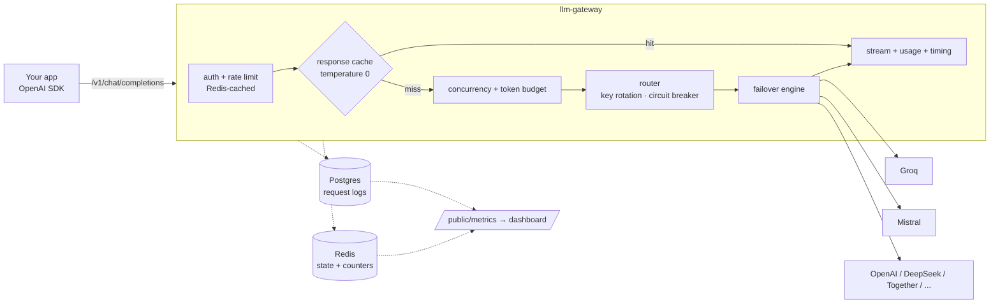

# llm-gateway

A self-hostable, OpenAI-compatible gateway that sits between your app and LLM providers and makes them
**reliable, fast and cost-controlled**. Point any OpenAI SDK at it by changing the `base_url`.



## The problems it solves

| Problem | What the gateway does |
|---|---|
| A provider has an outage or rate-limits you | Failover across models/providers and **every key you own**; a failed key cools down for 60s; a **circuit breaker** stops retrying a dead provider first on every request |
| A stream dies half-way | Detects truncated streams (no silent splicing of a second model's answer); optional `continue_on_failure` resumes on the next candidate |
| Same prompts, repeated cost and latency | Redis **response cache** for `temperature: 0` requests, epoch-based invalidation |
| One runaway client burns the budget | Per-key rate limit, per-project concurrency cap and **daily token budget** (settled to *actual* usage, not `max_tokens`) |
| Provider keys leaking | Provider keys encrypted at rest (AES-256-GCM); only ciphertext is ever cached in Redis |
| "What is happening?" | Per-request usage + timing in every response, and a metrics API built for a dashboard |

## Quickstart

```bash
cp .env.example .env            # fill ENCRYPTION_KEY (go run ./cmd/genkey) and ADMIN_TOKEN
docker compose up --build       # Postgres + Redis + gateway; migrations run on boot
```

```bash
# 1. a project, a provider key, and a gateway key
PID=$(curl -s -XPOST localhost:8080/admin/projects -H "Authorization: Bearer $ADMIN_TOKEN" \
        -d '{"name":"demo"}' | jq -r .id)
curl -XPOST localhost:8080/admin/credentials -H "Authorization: Bearer $ADMIN_TOKEN" \
        -d "{\"project_id\":\"$PID\",\"provider\":\"groq\",\"api_key\":\"gsk_...\"}"
KEY=$(curl -s -XPOST localhost:8080/admin/gateway-keys -H "Authorization: Bearer $ADMIN_TOKEN" \
        -d "{\"project_id\":\"$PID\"}" | jq -r .key)

# 2. use it like OpenAI
curl localhost:8080/v1/chat/completions -H "Authorization: Bearer $KEY" -d '{
  "model": "llama-3.3-70b-versatile",
  "fallback_models": ["mistral-large-latest", "cerebras:llama3.1-8b"],
  "temperature": 0,
  "messages": [{"role": "user", "content": "Say hi"}]
}'
```

```python
from openai import OpenAI
client = OpenAI(base_url="http://localhost:8080/v1", api_key=KEY)
client.chat.completions.create(model="llama-3.3-70b-versatile", messages=[...], stream=True,
                               stream_options={"include_usage": True})
```

## Usage and timing on every response

Non-streaming responses carry OpenAI's `usage` plus a `gateway` block, and the same facts as headers:

```json
{ "usage": {"prompt_tokens": 11, "completion_tokens": 7, "total_tokens": 18},
  "gateway": {"request_id": "req_…", "provider": "mistral", "model": "mistral-large-latest",
              "cache": "miss", "attempts": 2, "failovers": 1, "ttft_ms": 131, "total_ms": 402,
              "usage_estimated": false} }
```
`Server-Timing: total;dur=402, ttft;dur=131` · `X-Gateway-Provider` · `X-Gateway-Cache: hit|miss|bypass` · `X-Gateway-Request-Id`

Streaming sends the same `gateway` block on the final chunk, and `usage` when `stream_options.include_usage` is set.
If a provider reports no usage, tokens are estimated and `usage_estimated` is `true`.

## Providers

Anything that speaks the OpenAI chat-completions format is one line in `internal/providers/registry.go`.
Built in: **groq, mistral, openrouter, gemini, openai, deepseek, together, fireworks, cerebras, xai, deepinfra, sambanova**
(`GET /admin/providers`). Pick a model by bare name (common ones are mapped), `"provider": "..."`, or `"provider:model"`.
Override a base URL with `PROVIDER_<NAME>_BASE_URL`.

## Metrics API (for the dashboard)

* `GET /admin/metrics?project_id=<id>&window=1h|6h|24h|7d` (admin token)
* `GET /public/metrics?window=…` — **no auth, read-only, no keys/prompts/ids**, cached 10s. Enable with
  `PUBLIC_METRICS_ENABLED=true` and `CORS_ALLOWED_ORIGINS=https://your-site`.

One JSON document: `reliability` (success rate, **rescued by failover**, rescue rate, rate limits/outages absorbed,
circuit reroutes), `latency` (p50/p95/p99, TTFT), `cache` (hit rate, tokens saved, speed-up), `usage`,
`protection` (requests blocked by rate limit / budget / concurrency), `providers` (live scoreboard),
`top_models`, a gap-filled `timeseries`, and the last 15 `recent` requests.

## Try the failover demo (no API keys)

```bash
docker compose -f docker-compose.yml -f docker-compose.demo.yml up --build
docker compose exec gateway /app/loadtest seed -admin-url http://localhost:8080 -admin-token $ADMIN_TOKEN
docker compose exec gateway /app/loadtest run  -url http://localhost:8080 -key <gateway_key> -n 400 -c 20
curl -XPOST localhost:9001/chaos -d '{"mode":"down"}'      # kill the primary provider
docker compose exec gateway /app/loadtest run  -url http://localhost:8080 -key <gateway_key> -n 400 -c 20
curl localhost:8080/public/metrics?window=1h | jq .reliability
```
Chaos modes: `ok`, `down` (503), `ratelimit` (429), `flaky` (`{"mode":"flaky","rate":0.3}`).

Measured on a laptop against the mock upstream (primary killed, 300 fresh prompts, 20 concurrent):
**100% success**; only 18 requests ever touched the dead provider before the breaker opened, the other
452 went straight to the healthy one; cache hits ~1–5 ms vs ~400 ms for misses; gateway overhead ≈ 1 ms.

## Configuration

See [`.env.example`](.env.example) — every variable is documented there.

## Design notes

* **Hot path touches Postgres zero times.** Gateway-key lookup, project settings and (encrypted) provider
  credentials are read through Redis and invalidated on change (key revoke, `PATCH` project, new credential),
  so changes apply immediately. Measured: ~5.6 DB round trips per request → 1 (the request-log insert, which runs
  after the response is sent).
* **Atomic admission control.** Rate limit, budget and concurrency are single Lua scripts; budget reserves
  prompt+completion tokens up front and *settles* to real usage; concurrency slots self-expire so a crash can't
  lock a project out.
* **Cache correctness over hit rate.** Only explicit `temperature: 0`, no images, single clean attempt, `finish_reason: stop`.
  Keys are per project and embed an epoch: `DELETE /admin/projects/{id}/cache` invalidates everything in O(1),
  and a response that was in flight during the flush can't repopulate it.
* **Errors are real HTTP statuses** in OpenAI's JSON shape (400 bad request, 429, 502 all upstreams failed,
  503 no usable credentials); a failure before the first token never becomes a `200` with an error inside.

## Development

```bash
go test ./...        # DB/Redis tests skip unless DATABASE_URL / REDIS_URL / ENCRYPTION_KEY are set
go test -race ./...  # CI runs this against real Postgres + Redis
```
Live provider tests run only when `GROQ_API_KEY`, `MISTRAL_API_KEY`, … are set.
