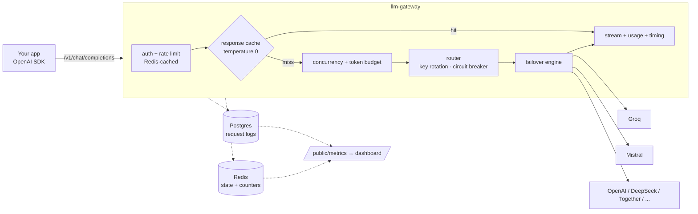
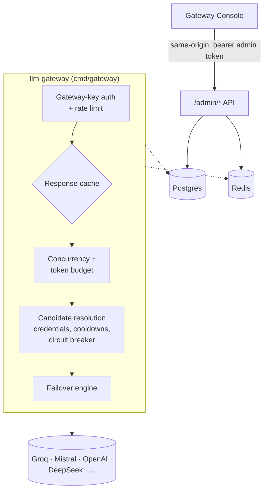
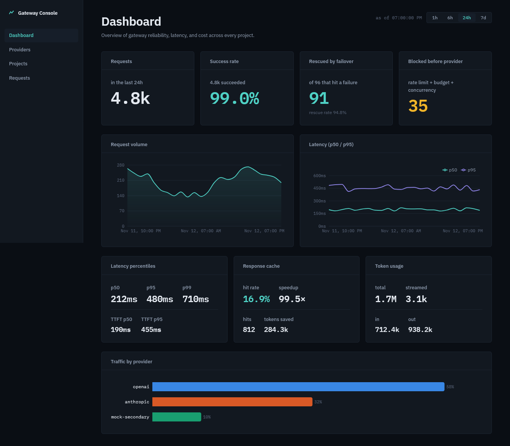

# llm-gateway


[](LICENSE)

**[Live Demo](https://llm-gateway-bx27zp9oo-studyhubplatform.vercel.app/demo) · [Architecture](ARCHITECTURE.md) · [Product Overview](PRODUCT_OVERVIEW.md) · [Security Policy](SECURITY.md) · [Changelog](CHANGELOG.md)**

llm-gateway is a self-hostable, **open source**, OpenAI-compatible reverse proxy that sits between your application and one or more LLM providers and makes that connection **reliable, fast, and cost-controlled** — without your application changing anything except the `base_url` it already points an OpenAI SDK at.

It's a backend-heavy project built around the problems that actually show up once an LLM-powered product has real traffic: a provider having an outage or rate-limiting you right when load spikes, a stream dying half-way through a response, the same deterministic prompt getting paid for over and over, one runaway client burning through a day's budget, and provider API keys scattered across config files with no central place to rotate or revoke them.

This is a monorepo with two apps:

- **the Go service** (`cmd/`, `internal/`) — the gateway itself: routing, failover, caching, admission control, and the admin/metrics API. Everything in this README outside the [Frontend](#frontend) section describes this service.
- **`web/`** — the **Gateway Console**, a Vite + React + TypeScript single-page app that is a pure client of the gateway's own `/admin/*` and `/public/metrics` API, with no backend of its own.

Clone it, bring your own provider keys (or use the zero-key [demo mode](#try-the-failover-demo-no-api-keys)), and run the whole stack with one `docker compose up`. MIT licensed — see [LICENSE](LICENSE).



---

## Why This Exists

Building on an LLM today means running into the same handful of unglamorous, business-critical problems no matter which provider you picked: that provider will have a bad minute (or a bad hour) eventually, and when it does, your app's reliability is only as good as whatever retry logic you remembered to write yourself — scattered across every service that happens to call a model. A stream can die half-way through an answer, and naively treating "it streamed something" as success risks silently serving a truncated fragment, or worse, splicing two different models' output together without anyone noticing. The same prompt gets sent, and paid for, again and again with no memory of having already produced that exact answer. A misconfigured client or a runaway loop can burn through a budget in minutes, and a budget checked against `max_tokens` rather than what was actually generated was never a real budget to begin with. And provider API keys end up pasted into `.env` files across a dozen services, with no single place to rotate one that leaked.

I built llm-gateway to put all of that in one place, built once, tested properly, instead of re-implemented — and under-tested — in every project that needs to call an LLM reliably. It's also where I went deep on the kind of correctness problems that don't show up in typical CRUD services: atomic admission control under real concurrent load (closing the exact race where two requests can both read "under budget" and both proceed), reserve-then-settle accounting so a budget reflects real usage instead of a worst-case reservation, and a cache that is deliberately conservative about what it's willing to serve back rather than optimized purely for hit rate.

## What It Does

**Automatic failover.** A request can list fallback models; the gateway builds an ordered chain across every model, provider, and credential a project owns, and tries them in sequence until one succeeds — invisibly to the caller, with the full attempt history available in the response if you want it.

**Stream-safe failure handling.** A stream that ends without a clean `finish_reason` is treated as a failure, never silently served as a complete answer. An opt-in `continue_on_failure` flag lets a caller explicitly accept a stitched continuation from the next candidate; without it, a mid-stream break fails the request cleanly instead of guessing.

**A correctness-first response cache.** Only requests that explicitly set `temperature: 0` are eligible, and only a clean, single-attempt, single-model answer is ever cached — a failed-over or continued response is never stored, because caching a degraded answer would mean serving it as if it were the primary model's clean output forever. Invalidation is epoch-based, so a flush is O(1) with no race against an in-flight write.

**Real cost control.** Per-key rate limiting, per-project concurrency capping, and a daily token budget — all three enforced atomically via single Redis Lua scripts before a request ever reaches a provider, and the budget *settles to actual usage* afterward rather than permanently charging the full `max_tokens` reservation.

**Encrypted credential storage.** Every provider API key is encrypted at rest with AES-256-GCM before it touches Postgres; only ciphertext is ever cached in Redis; no API, admin or otherwise, ever returns a stored key again once it's created.

**Full visibility.** Every response carries usage and timing metadata (provider, model, cache status, attempts, failovers, TTFT, total duration), and a metrics API — built specifically to drive a dashboard, not just dump raw numbers — reports reliability (including how many requests were *rescued* by failover), latency percentiles, cache performance, and a live per-provider scoreboard.

---

## In Action

### Failover, caching, and admission control, with no code changes to the calling app

```bash
curl localhost:8080/v1/chat/completions -H "Authorization: Bearer $KEY" -d '{
  "model": "llama-3.3-70b-versatile",
  "fallback_models": ["mistral-large-latest", "cerebras:llama3.1-8b"],
  "temperature": 0,
  "messages": [{"role": "user", "content": "Say hi"}]
}'
```

```python
from openai import OpenAI
client = OpenAI(base_url="http://localhost:8080/v1", api_key=KEY)
client.chat.completions.create(model="llama-3.3-70b-versatile", messages=[...], stream=True,
                               stream_options={"include_usage": True})
```

That's the entire integration surface — one `base_url`, one key, the rest of your application code doesn't change.

### Usage and timing on every response

Non-streaming responses carry OpenAI's `usage` plus a `gateway` block, and the same facts as headers:

```json
{ "usage": {"prompt_tokens": 11, "completion_tokens": 7, "total_tokens": 18},
  "gateway": {"request_id": "req_…", "provider": "mistral", "model": "mistral-large-latest",
              "cache": "miss", "attempts": 2, "failovers": 1, "ttft_ms": 131, "total_ms": 402,
              "usage_estimated": false} }
```
`Server-Timing: total;dur=402, ttft;dur=131` · `X-Gateway-Provider` · `X-Gateway-Cache: hit|miss|bypass` · `X-Gateway-Request-Id`

Streaming sends the same `gateway` block on the final chunk, and `usage` when `stream_options.include_usage` is set. If a provider reports no usage, tokens are estimated and `usage_estimated` is `true`.

---

## Quickstart

### Prerequisites

- Docker and Docker Compose (the easiest path — brings up Postgres, Redis, and the gateway together), **or** Go ≥ 1.25 plus your own Postgres and Redis instances for a native run.

### Run it

```bash
git clone https://github.com/Devpaul-01/llm-gateway
cd llm-gateway

cp .env.example .env            # fill ENCRYPTION_KEY (go run ./cmd/genkey) and ADMIN_TOKEN
docker compose up --build       # Postgres + Redis + gateway; migrations run on boot
```

### Set up a project and make your first request

```bash
# 1. a project, a provider key, and a gateway key
PID=$(curl -s -XPOST localhost:8080/admin/projects -H "Authorization: Bearer $ADMIN_TOKEN" \
        -d '{"name":"demo"}' | jq -r .id)
curl -XPOST localhost:8080/admin/credentials -H "Authorization: Bearer $ADMIN_TOKEN" \
        -d "{\"project_id\":\"$PID\",\"provider\":\"groq\",\"api_key\":\"gsk_...\"}"
KEY=$(curl -s -XPOST localhost:8080/admin/gateway-keys -H "Authorization: Bearer $ADMIN_TOKEN" \
        -d "{\"project_id\":\"$PID\"}" | jq -r .key)

# 2. use it like OpenAI — see "In Action" above
```

### Run the Gateway Console alongside it

```bash
cd web
npm install
npm run dev   # proxies /admin and /public to the gateway running on :8080
```

Open it, paste in your `ADMIN_TOKEN`, and you have a live dashboard over the stack you just started.

---

## Providers

Anything that speaks the OpenAI chat-completions format is one line in `internal/providers/registry.go` — every provider here shares a single adapter implementation, so adding a new one never requires new code.

Built in: **groq, mistral, openrouter, gemini, openai, deepseek, together, fireworks, cerebras, xai, deepinfra, sambanova** (`GET /admin/providers`). Pick a model by bare name (common ones are mapped), `"provider": "..."`, or `"provider:model"`. Override a base URL at runtime with `PROVIDER_<NAME>_BASE_URL` — no code change needed, which is exactly how the demo overlay below points providers at a local mock.

---

## Metrics API (for the dashboard)

* `GET /admin/metrics?project_id=<id>&window=1h|6h|24h|7d` (admin token)
* `GET /public/metrics?window=…` — **no auth, read-only, no keys/prompts/ids**, cached 10s. Enable with
  `PUBLIC_METRICS_ENABLED=true` and `CORS_ALLOWED_ORIGINS=https://your-site`.

One JSON document: `reliability` (success rate, **rescued by failover**, rescue rate, rate limits/outages absorbed, circuit reroutes), `latency` (p50/p95/p99, TTFT), `cache` (hit rate, tokens saved, speed-up), `usage`, `protection` (requests blocked by rate limit / budget / concurrency), `providers` (live scoreboard), `top_models`, a gap-filled `timeseries`, and the last 15 `recent` requests. Every field that can genuinely mean "no data" is `null`, never coerced to `0` — the Gateway Console renders that distinction explicitly rather than collapsing it.

This is the same document both the Dashboard and the public `/demo` page in the Gateway Console render — see [Frontend](#frontend).

---

## Try the Failover Demo (No API Keys)

**→ [Live demo](https://llm-gateway-bx27zp9oo-studyhubplatform.vercel.app/demo)** — see real reliability/latency/cache numbers from a running gateway with zero setup, no login, no API key.

```bash
docker compose -f docker-compose.yml -f docker-compose.demo.yml up --build
docker compose exec gateway /app/loadtest seed -admin-url http://localhost:8080 -admin-token $ADMIN_TOKEN
docker compose exec gateway /app/loadtest run  -url http://localhost:8080 -key <gateway_key> -n 400 -c 20
curl -XPOST localhost:9001/chaos -d '{"mode":"down"}'      # kill the primary provider
docker compose exec gateway /app/loadtest run  -url http://localhost:8080 -key <gateway_key> -n 400 -c 20
curl localhost:8080/public/metrics?window=1h | jq .reliability
```
Chaos modes: `ok`, `down` (503), `ratelimit` (429), `flaky` (`{"mode":"flaky","rate":0.3}`).

Measured on a laptop against the mock upstream (primary killed, 300 fresh prompts, 20 concurrent): **100% success**; only 18 requests ever touched the dead provider before the breaker opened, the other 452 went straight to the healthy one; cache hits ~1–5 ms vs ~400 ms for misses; gateway overhead ≈ 1 ms.

This is also what powers the Gateway Console's public, token-free `/demo` page — the same mock provider and load generator, reachable with zero setup.

---

## Architecture

The gateway is a single stateless Go binary with two dependencies: **Postgres** (system of record for projects, gateway keys, provider credentials, and a full request log) and **Redis** (everything on the hot path — auth cache, rate limits, budgets, concurrency slots, circuit breakers, credential cooldowns, and the response cache). There's no queue and no background worker process: the one thing that happens "after" a response is sent — writing its request-log row — is a short-lived, timeout-bounded goroutine, not a durable job, a deliberate tradeoff explained in [ARCHITECTURE.md §13.2](ARCHITECTURE.md#132-why-request-log-persistence-is-best-effort-async-not-a-durable-queue).

Key design properties, covered in full in [ARCHITECTURE.md](ARCHITECTURE.md):

- **The hot path never blocks on Postgres.** Gateway-key lookup, project settings, and provider credentials are all read through a Redis cache-aside layer with explicit invalidation on write, so a key revoke or a `PATCH` to a project's settings applies on the very next request, not after a cache TTL.
- **Atomic admission control.** Rate limiting, concurrency admission, and token-budget reservation are each one Redis Lua script — not a read-then-write pair — specifically to close the race where two concurrent requests could both read "under limit" and both proceed.
- **Fail open on availability, fail closed on correctness.** A Redis outage degrades toward "slower, more permissive," never toward serving wrong answers or leaking credentials; a truncated stream is never silently treated as a complete, billable success.
- **One shared provider adapter.** Every supported provider is driven through a single `OpenAICompatProvider`, parameterized by base URL and two behavior flags — adding a new provider is a registry entry, not a new file.



### Domain Model

```
Project
 ├─ Gateway Keys (hashed, revocable, scoped to this project)
 ├─ Provider Credentials (AES-256-GCM encrypted, per provider)
 └─ Request Logs (provider/model used, status, tokens, timing, cache hit,
                   attempts, failovers, every model tried)
```

Full request-lifecycle sequence diagrams, the failover engine's error taxonomy, the complete Redis key space, the Postgres schema (ERD), reliability design (circuit breaker, graceful shutdown, health checks), and deployment topology are all in [ARCHITECTURE.md](ARCHITECTURE.md).

---

## Admission Control

Three independent gates run before any provider is contacted, each individually configurable per project (falling back to a server-wide default):

| Gate | Mechanism | Scope | Default | Rejection |
|---|---|---|---|---|
| Rate limit | Sliding-window Lua script | Per gateway key | `DEFAULT_RATE_LIMIT_PER_MIN` (60/min) | `429 rate_limit_exceeded` |
| Concurrency | Self-expiring counter | Per project | `DEFAULT_MAX_CONCURRENT_STREAMS` (10) | `429 too_many_concurrent_requests` |
| Token budget | Reserve-then-settle counter | Per project, per UTC day | `DEFAULT_TOKEN_BUDGET` (100,000/day) | `429 daily_token_budget_exceeded`, `Retry-After` set |

Override any of these per project: `PATCH /admin/projects/{id} {"rate_limit_per_min": 120}`.

---

## Security

Provider API keys are encrypted at rest (AES-256-GCM, fresh nonce per encryption) and never returned by any API once stored — admin listing endpoints return only metadata (label, status, timestamps). Gateway keys are stored as a SHA-256 hash, never the plaintext; the plaintext is shown exactly once, at creation. Both gateway-key and credential revocation are immediate: the database write and the Redis cache eviction happen in the same call. CORS is applied to exactly one route (`/public/metrics`) — `/admin/*` and `/v1/*` get no CORS headers at all, so a browser script on another origin can't call them regardless of what token it might have. The admin token is compared in constant time.

This is a self-hosted project with a deliberately simple, explicit two-tier auth model (one gateway key per project, one admin token for everything administrative) rather than a multi-user RBAC system — appropriate to its current single-operator scope, and documented as such rather than left implicit. Full detail, including explicit known limitations, in [SECURITY.md](SECURITY.md). If you find a vulnerability, please report it privately — see [SECURITY.md §3](SECURITY.md#3-reporting-a-vulnerability) for how.

---

## Configuration

See [`.env.example`](.env.example) — every variable is documented there. The essentials:

| Variable | Required | Purpose |
|---|---|---|
| `DATABASE_URL` | Yes | Postgres connection string |
| `REDIS_URL` | Yes | Redis connection string |
| `ENCRYPTION_KEY` | Yes | 32-byte hex AES-256 key for provider credentials (`go run ./cmd/genkey`) |
| `ADMIN_TOKEN` | Yes | Bearer token for every `/admin/*` route (`openssl rand -hex 32`) |
| `PORT` | No (default `8080`) | HTTP listen port |
| `AUTO_MIGRATE` | No (default `true`) | Apply pending SQL migrations on boot — idempotent, advisory-locked |
| `DEFAULT_RATE_LIMIT_PER_MIN` / `DEFAULT_MAX_CONCURRENT_STREAMS` / `DEFAULT_TOKEN_BUDGET` | No | Server-wide defaults, overridable per project |
| `CACHE_ENABLED` / `CACHE_TTL_SECONDS` | No | Response cache toggle and TTL |
| `PUBLIC_METRICS_ENABLED` / `PUBLIC_METRICS_PROJECT_ID` / `CORS_ALLOWED_ORIGINS` | No | Unauthenticated `/public/metrics` for a status/portfolio page |
| `PROVIDER_<NAME>_BASE_URL` / `PROVIDER_<NAME>_STREAM_USAGE` | No | Per-provider overrides, e.g. pointing a provider at a mock or regional endpoint |

Provider API keys themselves are **not** environment variables — they're added per project through `POST /admin/credentials`, encrypted at rest (§ [Security](#security)).

---

## Project Structure

```
llm-gateway/
├── cmd/
│   ├── gateway/          # Production entrypoint
│   ├── genkey/            # Prints a random ENCRYPTION_KEY
│   ├── mockprovider/       # Fake OpenAI-compatible upstream with chaos modes
│   └── loadtest/            # Seed + load-generate against the admin/chat APIs
├── internal/
│   ├── httpserver/        # Routing, auth middleware, all HTTP handlers
│   ├── providers/          # Candidate resolution + the failover engine
│   ├── breaker/, cooldown/, budget/, concurrency/, ratelimit/, respcache/
│   │                        # The admission-control and reliability primitives
│   ├── credentials/, crypto/, gatewaykeys/
│   │                        # Encrypted credential storage and key management
│   ├── db/                 # Postgres pool + embedded SQL migrations
│   ├── insights/, metrics/, stats/, requestlog/
│   │                        # Everything that feeds the metrics API
│   └── ...                 # applog, config, discovery, projectsettings, redisclient
├── web/                   # Gateway Console — see Frontend below
├── deploy/                # Prometheus scrape config + a provisioned Grafana dashboard
├── scripts/                # Demo data seeding
├── docker-compose.yml      # Postgres + Redis + gateway + Prometheus + Grafana
├── docker-compose.demo.yml # Overlay: mock providers, no real API keys needed
└── .env.example
```

Full package-by-package breakdown in [ARCHITECTURE.md §4](ARCHITECTURE.md#4-repository-structure).

---

## Frontend

The `web/` app is the **Gateway Console** — a Vite + React 18 + TypeScript single-page app that is a pure client of the gateway's own API. It adds no backend of its own and no new routes to the Go service.



| Layer | Technology |
|---|---|
| Framework | React 18 (TypeScript), built/served with Vite |
| Routing | React Router |
| Server state | TanStack Query — the only state-management layer in the app |
| Charts | Recharts |
| Styling | Plain CSS with design tokens for a dark theme — no CSS framework |
| Auth | One operator-entered admin token, held in `sessionStorage`, sent as `Authorization: Bearer` on same-origin `/admin/*` calls |

**Pages:** Dashboard (reliability/latency/cache charts over a selectable window), Providers (per-provider scoreboard), Projects / Project Detail (settings, credentials, gateway keys), Requests (recent activity table), and a public, token-free `/demo` page that renders the `all`-window public metrics report for visitors with no admin token — falling back to a recorded-run fixture if the live endpoint is unreachable, so the demo never shows a broken page to a first-time visitor.

**It mirrors the backend's own correctness decisions in the UI**, not just its data: every latency/rate figure the backend can legitimately report as "no data" (a JSON `null`) is rendered as a visually distinct "—", never coerced to `0`, because collapsing that distinction would misrepresent real data.

**Deployment note:** because `/admin/*` intentionally has no CORS headers (see [Security](#security)), the Gateway Console **must** be served same-origin with the gateway in any real deployment — a reverse-proxy routing decision at deploy time, not something the backend widens its CORS policy to work around.

```bash
cd web
npm install
npm run dev      # dev server, proxies /admin and /public to the gateway
npm run build    # production build
npm test         # Vitest + React Testing Library
```

Full frontend architecture — project structure, API client design, the settings form's tri-state update semantics, and the demo page's fallback behavior — is covered in [ARCHITECTURE.md §16](ARCHITECTURE.md#16-frontend-architecture-summary).

---

## Development

```bash
go test ./...        # DB/Redis tests skip unless DATABASE_URL / REDIS_URL / ENCRYPTION_KEY are set
go test -race ./...  # CI runs this against real Postgres + Redis
```
Live provider tests run only when `GROQ_API_KEY`, `MISTRAL_API_KEY`, … are set. Frontend tests: `cd web && npm test`. CI (`.github/workflows/ci.yml`) runs `go build`, `go vet`, a `gofmt` check, the full test suite (including `-race`) against real Postgres and Redis service containers, and a Docker image build, on every push and pull request to `main`.

---

## Self-Hosting

llm-gateway is built to be run by you, on your own infrastructure, with your own provider accounts — not as a hosted service this repository offers. The whole stack is one Go binary plus Postgres and Redis; the production container is a multi-stage build landing on a minimal, non-root, distroless final image (no shell, no package manager) with database migrations applying themselves automatically on boot. See [Quickstart](#quickstart) to run it locally, [ARCHITECTURE.md §15](ARCHITECTURE.md#15-deployment-topology) for the deployment topology and container details, and [Configuration](#configuration) for every environment variable a real deployment needs to set.

## Contributing

Issues and pull requests are welcome. Please run `go test -race ./...` (and `npm test` under `web/` for frontend changes) before opening a PR, and keep CI's `gofmt`/`go vet` checks green.

## License

MIT — see [LICENSE](LICENSE).

---

Further reading: [ARCHITECTURE.md](ARCHITECTURE.md) for the full system design, [SECURITY.md](SECURITY.md) for the complete security policy, [PRODUCT_OVERVIEW.md](PRODUCT_OVERVIEW.md) for the product/feature reference, and [CHANGELOG.md](CHANGELOG.md) for the project's history.
